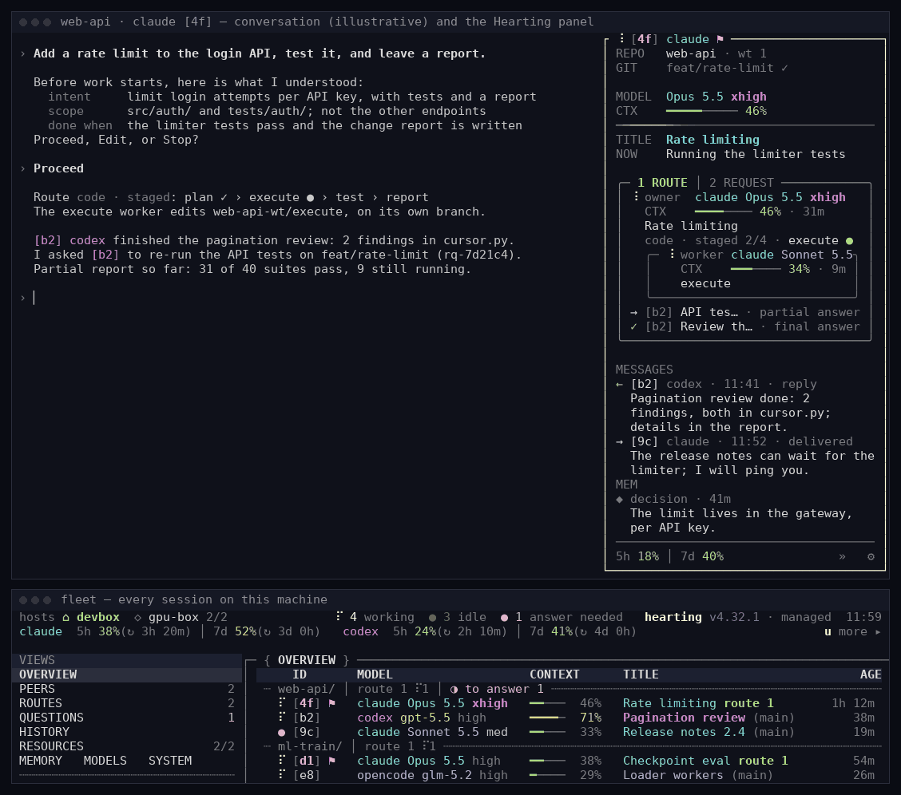
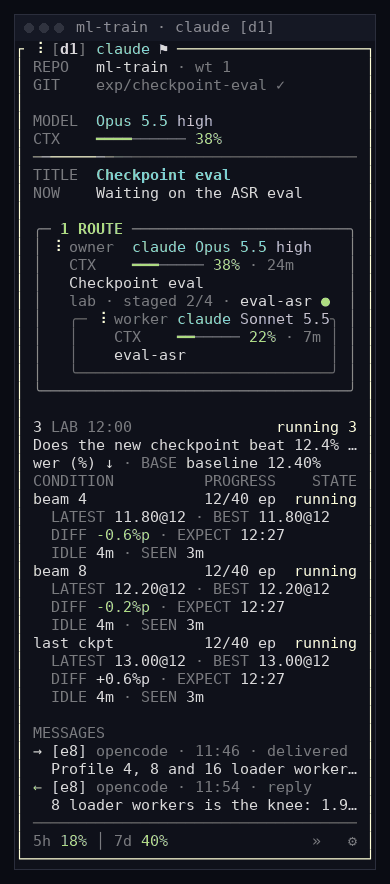
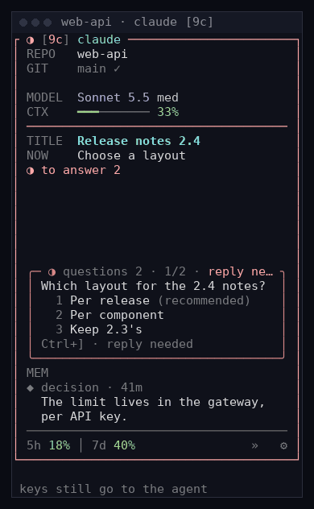
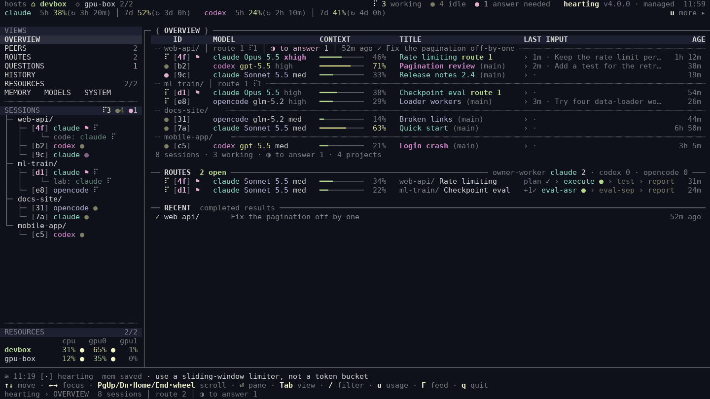
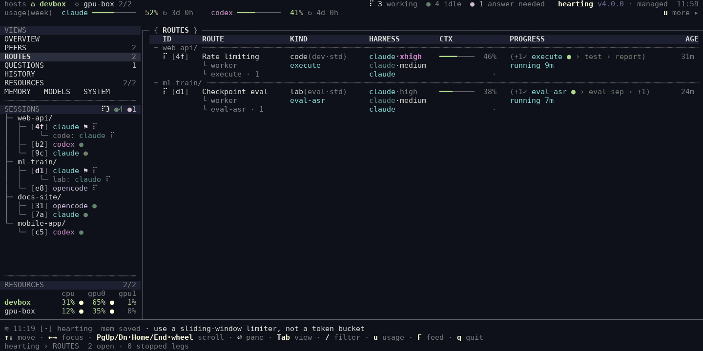
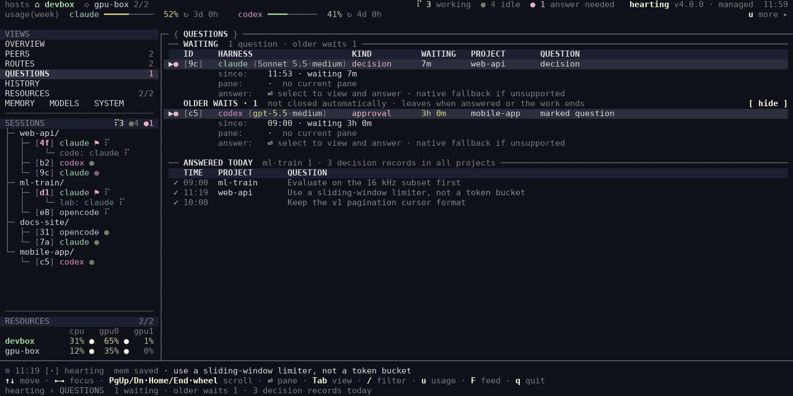
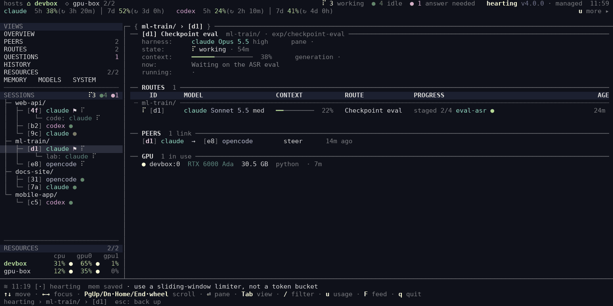
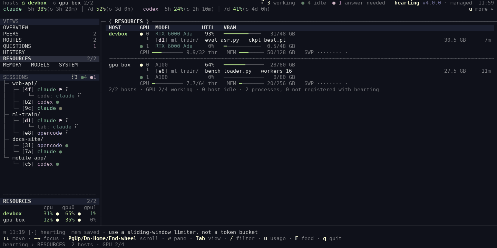
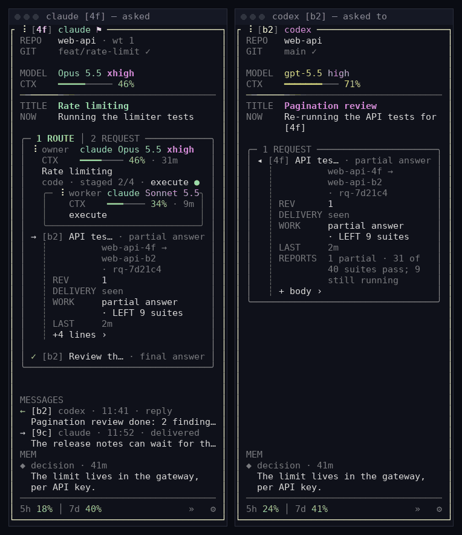

<p align="center">
  <picture>
    <source media="(prefers-color-scheme: dark)" srcset="docs/brand/hearting-mark-dark.svg">
    <source media="(prefers-color-scheme: light)" srcset="docs/brand/hearting-mark-light.svg">
    
  </picture>
</p>

<h1 align="center">Hearting</h1>

<p align="center"><strong>모든 코딩 에이전트를 한 자리에서 감독합니다 — Claude Code, Codex, OpenCode 어디서든.</strong></p>

<p align="center">세션마다 옆 패널에 route·작업자·메시지가 보이고, Fleet는 모든 세션과 지금 답을 기다리는 세션을 보여 줍니다.<br>
강한 모델이 계획을 정하고, 싼 작업자가 작게 확인받으며 실행합니다.</p>

<p align="center">
  
  
  
  
  
</p>

<p align="center"><a href="README.md">English</a> · <strong>한국어</strong></p>

<p align="center">
  <a href="#빠른-시작">빠른 시작</a> ·
  <a href="#한-자리에서-모든-세션">한 자리에서</a> ·
  <a href="https://dmlguq456.github.io/hearting/fleet.html">Fleet 둘러보기 ↗</a> ·
  <a href="https://dmlguq456.github.io/hearting/">웹사이트 ↗</a> ·
  <a href="FAQ.ko.md">자주 묻는 질문</a>
</p>

> 이 문서는 유지보수 기준인 [README.md](README.md)의 한국어 번역입니다.
> 명령, 경로, 설정 키와 식별자는 영문 원문을 기준으로 합니다.

<p align="center">
  
</p>
<p align="center"><sub>세션 <code>[4f]</code>와 그 패널, 아래는 Fleet입니다. 패널 머리와 Fleet의 <code>[4f]</code> 행이 같은 값을 보여 줍니다. 패널과 Fleet는 하팅 자체 렌더러가 합성 데모 데이터로 그렸고, 왼쪽 대화는 예시입니다.</sub></p>

## 왜 하팅인가

에이전트는 회사마다, 모델마다, 쓸 수 있는 환경마다 다릅니다. 그렇다고
에이전트 없이 일할 수는 없습니다. 하팅은 그 차이 속에서도 일하는 방식을
하나로 지켜 줍니다. 중심은 사용자이고, 에이전트가 스스로 하는 몫이 작아도
일이 흐트러지지 않게 합니다.

- **에이전트가 달라도 일관되게.** 하팅은 일을 시작하기 전에 의도를 사용자와
  확인하고, 작업자마다 범위를 정해 두고, 결과를 따로 검사합니다. 그래서 일이
  에이전트의 실력이 아니라 사용자가 요청한 내용에 묶여 있습니다.
- **어디서든 하나의 방식.** Claude Code, Codex, OpenCode 어느 쪽이든, 하나만
  쓰든 셋을 같이 쓰든 같은 요청, 단계, 산출물, 메모리, 패널, Fleet로 일합니다.
- **모든 기록을 한 화면에.** 어느 하네스의 세션이든 같은 기록을 남기고, 세션마다
  패널과 Fleet가 그것을 읽습니다. 세션마다 지금 하는 일, 열린 요청과 그 단계,
  사용자의 답을 기다리는 질문, 정한 것과 아직 남은 것이 보입니다.
- **저비용 에이전트의 목발.** 하팅이 약한 모델을 똑똑하게 만들 수는 없습니다.
  대신 약한 모델도 사용자의 의도를 끝까지 수행하게 합니다. 강한 모델이 의도와
  계획을 정하고(*frame*), 싼 작업자가 작은 단위로 확인받으며 실행합니다
  (*분사*, dispatch).
- **에이전트의 부담은 가볍게.** 에이전트가 긴 절차를 외워야만 돌아가는 단계를
  만들지 않습니다. 절차는 하네스가 들고 있습니다.
- **이미 있는 것부터.** 계획 전에 싼 읽기 전용 탐색이 코드, 이전 산출물,
  메모리, git 기록에 이미 정해진 것을 추려 줍니다.

## 한 자리에서 모든 세션

세션마다 옆에 패널이 붙고, Fleet가 모든 세션을 한꺼번에 보여 주며, 세션끼리
일을 추적되는 요청으로 맡깁니다. 셋 다 같은 기록을 읽으므로, 한 세션의 패널이
말하는 것과 Fleet가 그 세션에 대해 말하는 것이 같습니다.

### 세션 옆 패널

새 설치에서는 새로 여는 Claude Code, Codex, OpenCode 터미널마다 오른쪽에 40칸
패널이 열립니다. 위에서부터 프로젝트와 Git 상태, 모델과 문맥, 세션 제목과 지금
하는 일, route마다 owner와 지금 단계를 도는 작업자, 이 세션이 맡기거나 받은
요청, 이 프로젝트의 실험(`LAB`), 최근 메시지, 저장된 기억(`MEM`), 사용량 창이
보입니다. 사용자의 답을 기다리는 질문은 따로 상자에 뜹니다. **Ctrl+]**로 패널에
들어가 **Tab**, **1–9**, **Enter**로 답하거나, **f**로 같은 창에서 Fleet를 엽니다.
**Ctrl+]**를 다시 누르면 입력으로 돌아갑니다. `hearting session shell disable`은
새 터미널부터 패널을 끕니다. 키, 설정, 좁은 창 배치, 하네스별 세부는
[docs/session-panel.md](docs/session-panel.md)(영어)에 있습니다.

<table>
  <tr>
    <td width="50%" valign="top"><br><sub><b>패널 하나</b> — 작업자가 붙은 lab route, 그 자리에서 펼친 프로젝트 <code>LAB</code> 표, 메시지.</sub></td>
    <td width="50%" valign="top"><br><sub><b>답하기</b> — Ctrl+] → Tab → 2 → Enter → Ctrl+]. 데모 데이터.</sub></td>
  </tr>
</table>

### Fleet: 모든 세션을 한꺼번에

Fleet는 이 기계의 모든 Claude Code, Codex, OpenCode 세션과 하팅이 그 세션들에서
분사한 모든 작업자를 터미널 화면 하나로 보여 줍니다. 각각이 도는지, 멈췄는지,
사용자를 기다리는지가 보입니다.

<p align="center">
  
</p>
<p align="center"><sub>OVERVIEW → ROUTES → 세션 페이지 → 그 세션의 패널 → 요청의 원문 출력. 데모 데이터.</sub></p>

| 화면 | 알려 주는 것 |
|---|---|
| **OVERVIEW** | 프로젝트별로 묶은 모든 세션과, 프로젝트마다 열린 요청, 사용자 답을 기다리는 질문, 최근 결과. 세션마다 하네스, 모델, 남은 문맥, 지금 하는 일과 지난 시간. 펼치면 내가 마지막으로 입력한 말과 받은 메시지가 나옵니다. |
| **ROUTES** | 요청마다 지금 하는 쪽과 지금 위치(`one-shot`, 단계마다 작업자를 띄우면 `staged 3/7 execute ●`)와 그 아래에서 도는 작업자. |
| **QUESTIONS** | 사용자의 답이나 승인을 기다리는 모든 에이전트와 언제부터인지, 어떻게 답하는지. 하네스가 답 경로를 주면 Fleet에서 바로 답하고, 아니면 해당 세션으로 안내합니다. |
| **RESOURCES** | 이 기계와 설정한 호스트의 CPU, 메모리, GPU별 사용량과 각 GPU 프로세스를 가진 세션. |
| **그 밖의 화면** | PEERS(어떤 세션이 어떤 세션을 지켜보거나 조정하는지), HISTORY, MEMORY, MODELS · SYSTEM. 프로젝트를 고르면 현황, 남은 일, route, 결과, 그 프로젝트의 `LAB` 표가 나옵니다. |

<table>
  <tr>
    <td width="50%"><br><sub><b>ROUTES</b> — 요청마다 단계 줄과 그 단계를 도는 작업자.</sub></td>
    <td width="50%"><br><sub><b>QUESTIONS</b> — 무엇이 답을 기다리는지, 언제부터인지, 어떻게 답하는지.</sub></td>
  </tr>
  <tr>
    <td width="50%"><br><sub><b>세션 페이지</b> — 상태, 문맥, 지금 하는 일, route, 연결된 세션, GPU.</sub></td>
    <td width="50%"><br><sub><b>RESOURCES</b> — GPU별 사용량과 각 프로세스 뒤의 세션과 명령.</sub></td>
  </tr>
</table>

패널과 Fleet는 서로를 엽니다. 패널에 들어간 상태에서 **f**는 그 창에서 Fleet를
열고, Fleet의 세션 페이지에서 **Ctrl+]**는 정확히 그 세션의 패널을 엽니다.
기다리는 질문에는 어느 쪽에서나 답할 수 있습니다. 좁은 터미널에서도 배치가
유지됩니다([100열 OVERVIEW](docs/fleet/narrow.png)).

```bash
fleet              # Explorer 전체 화면(curses 필요)
fleet --once       # 단순 스냅숏 한 번
fleet --json       # 같은 상태를 JSON으로(스크립트용)
```

**알려진 한계.** Fleet는 아직 가볍지 않습니다. 작업 이력이 길고 살아 있는 세션이
많은 기계에서 Explorer 창 하나가 CPU 한 코어의 약 3분의 1과 메모리 약 0.8 GB를
썼습니다. 새로 띄운 창은 세션 목록을 읽자마자 첫 화면을 그리고, 아직 읽는 칸은
`details wait`(한국어 화면은 "세부 아직")로 표시합니다.

### 세션끼리 주고받기

세션은 다른 세션에 일을 추적되는 **요청**으로 맡길 수 있습니다. 평소 말로
하면 됩니다 — “세션 [b2]에 feat/rate-limit에서 API 시험을 다시 돌리고 보고해
달라고 해줘.” 요청에는 번호가 붙습니다. 상대 세션은 짧은 줄 하나를 받고 본문은
스스로 엽니다. 일하는 동안 일부 보고를, 끝나면 최종 보고나 거절을 보내고, 보고가
올 때마다 맡긴 세션이 깨어납니다. 맡긴 쪽은 새 판을 보내거나 취소할 수 있고,
요청은 하팅이 확인한 인계일 때만 상대의 후임 세션으로 따라갑니다. 두 패널 모두
요청이 닫힐 때까지 보여 줍니다. `→`는 내가 맡긴 일, `◂`는 내가 받은 일, `✓`는
끝난 일입니다.

<p align="center">
  
</p>
<p align="center"><sub>같은 요청이 맡긴 세션(<code>[4f]</code>)과 맡은 세션(<code>[b2]</code>)의 패널에 보입니다. 데모 데이터.</sub></p>

짧은 메시지와 감시도 같은 방식입니다. 세션은 다른 세션에 쪽지를 보내거나, 그
세션을 지켜보다가 끝나거나 멈추거나 사용자를 기다릴 때 한 번 깨어날 수 있습니다.
이 가운데 어느 것도 herdr나 tmux가 필요하지 않고, 하팅 자체 기록으로 돕니다. 쉬고
있는 세션에 얼마나 빨리 닿는지는 하네스마다 다릅니다([하네스와
모델](#하네스와-모델)). Fleet는 아직 요청 목록을 보여 주지 않고, Fleet에서 요청을
보낼 수도 아직 없습니다. 스크립트에서는 `hearting run peer-steward request`,
`report`, `show`를 씁니다([core/OPERATIONS.md](core/OPERATIONS.md)의 “Peer requests”).

### 화면을 믿을 수 있는 이유

- **같은 기록, 같은 값.** 패널과 Fleet는 분사 기록부(dispatcher가 쓰는 attempt
  registry)와 각 하네스의 세션 상태를 읽습니다. 멈춘 작업자는 "조용해진 부모
  세션"이 아니라 멈춘 작업자로 보입니다.
- **모르는 것은 모른다고.** 읽지 못한 값은 `?`로 표시합니다. 0이나 성공으로
  바꾸지 않습니다.
- **보기만으로는 아무것도 바뀌지 않습니다.** 관찰이 작업을 끝내거나, 다시
  돌리거나, 정리하지 않습니다. 패널과 Fleet는 사용자가 고른 일, 예를 들어
  기다리는 질문에 대한 답만 수행합니다.

## 요청이 처리되는 방식

원하는 결과를 평소 말로 설명하면 됩니다. 외울 명령 이름이 없고, 출력은 대화
언어를 따릅니다.

> “로그인 API를 구현하고 테스트한 뒤 변경 보고서까지 남겨줘.”

```text
요청
  ├─ prior-art 탐색    프로젝트에 이미 있는 것: 코드, 산출물, 메모리, git 기록
  ├─ frame             강한 모델 두 갈래가 진행 경로를 제안하고, 고를 것이 있을 때만 사용자에게 물음
  └─ owner             세션 하나가 요청과 완료 기준을 끝까지 붙듦
       ├─ plan ─► plan check
       ├─ execute      싼 작업자. 소스를 고치는 단계는 이것 하나
       ├─ test, review 독립 검사. 가능하면 다른 하네스에서
       └─ report       무엇을 바꾸고, 무엇을 확인했고, 무엇이 남았는지
                       … 이 모든 단계를 패널과 Fleet가 실시간으로 보여 줌
```

사용자가 맡긴 일이 시작되기 전에 에이전트는 짧은 카드 하나를 보여 줍니다.
사용자가 한 말과 에이전트가 이해한 의도, 범위, 안 할 것, 완료 기준이 담깁니다.
진행, 수정, 중단 중에 답하면 그 내용이 요청과 함께 owner와 모든 작업자에게
전달됩니다. frame의 두 갈래가 같은 방향을 내고 사용자가 고를 것이 없으면 한 줄
통지와 함께 바로 시작하고, 고칠 점은 다음 말로 알려 주면 됩니다. 분사한 요청이
끝나면 의도, 결과, 비용(걸린 시간과 세션 토큰), 바뀐 것, 확인한 것, 남은 것을
짧게 요약해 받습니다. 알림이 여럿 한꺼번에 오면 실패와 주의가 필요한 것이 먼저
오고, 정상 경과는 한 줄로 묶입니다.

얼마나 많은 단계가 돌지는 요청에 따라 다릅니다. 한 줄 답이나 아주 작고 되돌릴
수 있는 수정은 사용자의 폴더에서 바로 처리하고 자동으로 기록합니다. 경로가
필요한 작은 변경은 frame과 빠른 작업자 하나로 끝냅니다(`quick`). 크거나 위험한
일은 계획서, 독립 검토, 마지막에는 적대적 검사나 보안 검사까지 더합니다
(`standard → strong → thorough → adversarial`). 단계마다 그 단계에 맞는 모델
예산(`deep`, `balanced-deep`, `balanced`, `light`, `mini`)을 쓰고, 각 예산에 어떤
실제 모델을 쓸지는 사용자가 정합니다([하네스와 모델](#하네스와-모델)).

카드, 요약, 패널과 Fleet의 낱말처럼 하팅이 직접 찍는 고정 문구는 한국어를 한 번
선언하기 전까지 영어입니다([자주 묻는 질문](FAQ.ko.md#언어-설정이-모든-문구를-번역하나요)).
전체 진입점은 [capabilities/README.md](capabilities/README.md), 경로 선택 규칙은
[core/WORKFLOW.md](core/WORKFLOW.md)에 있습니다.

## 빠른 시작

**필요한 것**: Linux 또는 macOS(Windows의 Git Bash는 실험적), PyYAML이 있는
Python 3.11 이상(`python3 -m pip install --user pyyaml` 또는 `python3-yaml` 같은
OS 패키지), Git, `curl` 또는 `wget`, 그리고 설치하고 로그인한 에이전트 CLI 하나
이상: Claude Code, Codex, OpenCode 중 하나. Claude Code 하나만으로도 됩니다. CI가
Ubuntu에서 셋 모두의 설치를 확인하며, macOS는 처음부터 끝까지 확인하지 않았습니다.

```bash
curl -fsSL https://github.com/dmlguq456/hearting/releases/latest/download/install.sh | sh
~/.local/bin/hearting runtime doctor --runtime all --strict
```

Claude Code만 쓰려면 `sh` 뒤에 `-s -- --runtime claude`를 붙이고 `runtime doctor`에
`--runtime claude`를 씁니다. 설치기는 설치할 아카이브와 같은 릴리스 태그에서 오며,
먼저 그 아카이브의 SHA-256을 확인합니다. `hearting`, `fleet`, `fleet-monitor`,
`mem`, `compute-hosts`를 `~/.local/bin`에 두고, OS가 지원하면 매일 업데이트 확인을
등록합니다. 하네스의 자격 증명, 세션, 로그, 데이터베이스, 셸 시작 파일은 건드리지
않으므로, `~/.local/bin`을 `PATH`에 넣기 전까지는 `~/.local/bin/...` 경로를 쓰세요.
설치기가 작업자 기본 권한에 대한 안내를 출력합니다.
[자주 묻는 질문](FAQ.ko.md#백그라운드-작업자는-어떤-권한을-갖나요)에 설명이 있습니다.

### 처음 5분

1. **설치**는 위 두 줄입니다. `runtime doctor`가 빠진 선택 요소와 그것 없이 안
   되는 일을 알려 줍니다.
2. **Git 프로젝트 안에서 에이전트 CLI를 엽니다.** 새 터미널 오른쪽에 하팅 패널이
   뜹니다.
3. **작은 일을 맡깁니다:** “인사 출력의 오타를 고치고 기존 시험을 돌린 뒤 diff를
   보여줘.” 패널의 `NOW`가 일을 따라가고, 끝나면 바뀐 내용, 확인을 위해 실행한
   것, 못 한 일을 받습니다.
4. **다른 터미널에서 세션을 하나 더 엽니다.** 하네스는 달라도 됩니다. 어느 쪽에서든
   **Ctrl+]** 다음 **f**를 누르면 Fleet에 두 세션이 번호와 함께 보입니다.
5. **일을 넘깁니다:** 첫 세션에 “세션 [b2]에 시험을 다시 돌리고 보고해 달라고
   해줘”라고 말합니다(둘째 세션의 번호를 씁니다). 요청이 두 패널에 보이고, 보고가
   오면 첫 세션이 깨어납니다.
6. **결과는** 프로젝트의 `.agent_reports/` 폴더에 있고, `hearting reports`로 목록을
   봅니다.

3번 같은 작고 되돌릴 수 있는 수정은 사용자의 폴더에서 바로 하고 자동으로
기록합니다. 바뀐 파일, 확인으로 돌린 명령, 마지막 답이 남습니다. 이 기록은 수정이나
시험이 통과했는지 판단하지 않으며, 끄려면 `HEARTING_AUTO_RECORD=off`를 설정하세요.
더 큰 변경은 프로젝트 옆의 별도 git worktree `<project>-wt/<name>`에서 자기
브랜치로 하므로, 사용자의 폴더는 그대로입니다. [빠른 시작 안내](QUICKSTART.ko.md)는
작은 데모 파일로 이 과정을 따라가며 실측 시간을 보여 줍니다.

### 업데이트와 상태

```bash
hearting runtime status --runtime all   # 활성 릴리스, 최신 여부, 세션을 다시 열어야 하는지
hearting update                         # 새 릴리스를 준비·검증한 뒤 전환, 실패하면 되돌림
hearting config status                  # 사용자가 소유한 모든 설정 파일과 그 상태
hearting session shell status           # 새 터미널이 패널과 함께 열리는지
```

업데이트가 이미 열린 세션의 지침을 다시 읽게 하지는 않습니다. `runtime status`가
하네스마다 재호출, 새 세션, 재시작 중 무엇이 필요한지 알려 줍니다. 릴리스를
고정하거나 예약 확인을 끄려면 그 릴리스의 설치기를 `--no-auto-update`와 함께
쓰세요. 체크섬은 전송 중 손상이나 파일 손상을 잡습니다. 배포자 진위는 이 저장소의
GitHub Release와 HTTPS에 기대며, 별도 서명은 없습니다.

## 산출물과 기억

일은 대화 기록만이 아니라 읽을 수 있는 파일로 남습니다. 프로젝트마다 산출물
루트 `.agent_reports/`가 하나 있고, 모든 하네스와 그 프로젝트의 모든 git
worktree가 함께 씁니다. 계획이 필요한 일은 `campaigns/<campaign>/<cycle>/artifacts/`
아래 회차(cycle) 폴더 하나를 씁니다(`plans/`, `research/`, `spec/`, `documents/`,
`experiments/`). campaign은 관련된 요청을 묶습니다. 작은 직접 작업과 자동 턴
기록은 cycle 폴더 대신 campaign의 하루 일지(`journals/YYYY-MM-DD.md`)에 모이며,
저장됨이 시험 통과를 뜻하지는 않습니다. campaign은 `STATUS.md`를 둘 수 있고,
Fleet가 프로젝트 화면에 보여 줍니다. `hearting reports`가 최근 결과를 보여 주고,
`hearting open <번호 또는 검색어>`가 하나를 열며, `hearting view`가 로컬 뷰어를
띄웁니다. 일이 막혔다고 `.agent_reports/`를 지우지 마세요. 다음 단계가 거기 남은
근거를 읽습니다.

결정과 규칙은 이 기계의 모든 세션, 프로젝트, 하네스가 함께 쓰는 로컬 기억 저장소
하나에 남습니다. `${XDG_DATA_HOME:-~/.local/share}/hearting/memory/` 아래 전문
검색이 되는 SQLite입니다. 무엇이 중요한지는 에이전트가 판단하고, 쓰기 전에 기록
전문을 읽습니다. 바뀐 결정은 옛 결정을 지우지 않고 대체합니다. 쉬는 세션은 다음
세션을 위한 짧은 카드를 남기고 하네스 자체의 압축으로 대화를 줄입니다. Claude
Code에서는 둘이 겹치지 않도록 설치가 Claude 자체의 쉬는 동안 압축을
끄고(`idleCompaction: false`), 제거하면 원래 값으로 되돌립니다. 기억은
[교환](INSTALL_LAYOUT.md#shared-memory-exchange)에 참여하기 전까지 로컬에 머물고,
`mem recall "naming convention"`으로 바로 찾을 수 있습니다. 자세한 내용은
[core/MEMORY.md](core/MEMORY.md)에 있습니다.

## 하네스와 모델

| 하네스 | 하팅이 그 하네스 고유의 발견 경로로 더하는 것 |
|---|---|
| Claude Code | Skill, agent, command, hook |
| Codex | Skill, custom agent, mode, hook |
| OpenCode | Skill, agent, command, 로컬 guard plugin |

모든 하네스가 전체 기능을 보고, 하네스에 없는 표면은 설치기가 이유와 함께
`SKIP`으로 표시합니다. 하네스를 둘 이상 설치하면 하팅이 작업자와 독립 검토를 여러
하네스에 나눠 둘 수 있습니다. 패널, 요청, Fleet는 셋이 같지만, 쉬고 있는 세션에
닿는 방식은 다릅니다.

| | Claude Code | Codex | OpenCode |
|---|---|---|---|
| 패널 | 됨 | 됨 | 됨 |
| 쉬고 있는 세션에 메시지·요청·보고가 닿는 때 | 패널이 있는 터미널에서는 바로, 그 밖에서는 그 세션의 다음 턴에 | 자체 thread queue로 바로 | 패널이 있는 터미널에서는 바로, 그 밖에서는 다음 idle이나 도구 callback에 |
| 지켜보는 세션이 끝나거나 사용자를 기다릴 때 깨어나나 | 깨어남 | 하팅이 그 터미널을 확인한 곳에서 깨어남, 아니면 기다릴 명령을 받음 | 기다릴 명령을 받음 |

공통 계약은 벤더 모델이 아니라 예산 이름을 씁니다. 하네스마다 예산을 실제 모델로
잇는 사용자 소유 파일 `<runtime-home>/agent-config/models.conf`가 있고, 설치 때 한
번 만들어진 뒤 덮어쓰지 않습니다. `light` 일에 더 싼 모델을 두는 곳이 여기입니다.

```bash
hearting model set codex light <model>[@effort]
hearting model get claude context-window --json
hearting model set claude context-window 800000
```

문맥 예산 기본값은 Claude Code와 OpenCode가 800,000 토큰, Codex가 1,000,000
토큰입니다(선택한 모델의 최대치를 넘지 않음). 새 세션부터 바뀐 설정을 씁니다.
하팅이 더하는 몫은 작지만 공짜는 아닙니다. Codex에서 한 기계로 세 번씩 잰 결과,
첫 반응이 약 0.7초 늦었고 요청마다 입력이 약 2.4K 토큰 늘었습니다. 자세한 내용은
[INSTALL_LAYOUT.md](INSTALL_LAYOUT.md#user-model-configuration)에 있습니다.

## 선택 기능

아래는 기본 작업에 필요하지 않습니다.

- **herdr 또는 tmux** — 터미널 창 관리 도구. 둘 중 하나가 있으면 하팅이 peer 창을
  열고 닫거나 pane 제목을 붙이고, 질문 알림이 그 창으로 갑니다. 데스크톱 세션은
  질문 알림을 `notify-send`로도 받습니다. 메시지, 요청, 감시, 패널에는 둘 다
  필요 없습니다.
- **패널**은 새 설치에서 기본으로 켜집니다. `hearting session shell disable`은
  원래 실행 방식으로 되돌리고 `enable`은 다시 켭니다. 실행 중인 세션에는 영향이
  없습니다.
- **연산 호스트와 GPU** — `compute-hosts`는
  `${XDG_CONFIG_HOME:-$HOME/.config}/hearting/compute-hosts.yaml`을 읽고, 이 파일은
  주석 달린 예시로 만들어집니다. 파일이 없어도 Fleet는 이 기계의 CPU와 GPU
  사용량을 보여 줍니다.
- **외부 산출물 도구** — 완성된 산출물을 따로 연결한 도구(문서 열람기 등)로 보낼
  수 있습니다. 연결한 도구가 없으면 그 단계만 사용할 수 없다고 알립니다.
- **기계 간 기억 교환** — [산출물과 기억](#산출물과-기억)을 보세요.

## 하팅이 하지 않는 것

| 하지 않는 것 | 대신 |
|---|---|
| 에이전트 CLI를 대체하기 | Claude Code, Codex, OpenCode는 벤더 소유 그대로이고, 하팅은 각 하네스 고유의 발견 경로로 더해집니다 |
| 자격 증명, 세션, 로그, 하네스 데이터베이스 건드리기 | 각 하네스가 소유합니다 |
| 셸 시작 파일 고치기 | `~/.local/bin`을 `PATH`에 넣는 일은 사용자가 합니다 |
| 설치만으로 GPU 작업을 예약하거나 원격 에이전트 띄우기 | 연산은 사용자가 지정한 호스트에서만 돕니다 |
| 메모리를 기본으로 어딘가에 보내기 | 교환에 참여하기 전까지 메모리는 로컬에 머뭅니다 |
| 약한 모델을 똑똑하게 만들기 | 약한 모델에게 확인된 계획과 작은 확인 단계를 줍니다 |
| 요금 추정하기 | 패널과 Fleet는 하네스가 알려 주는 사용량 한도와 토큰 수를 보여 줄 뿐, 청구액이나 한도 예측이 아닙니다 |

## 하팅 개발

```bash
git clone https://github.com/dmlguq456/hearting.git ~/hearting
cd ~/hearting
./tools/install/harness.sh runtime activate --runtime all
git config core.hooksPath tools/git-hooks
```

공통 동작은 `core/`, `capabilities/`, `roles/`에서 시작합니다. `adapters/` 아래
세 어댑터는 그것을 동등하게 투영한 것이며, 하팅의 목적과 유지보수 원칙은
[AGENTS.md](AGENTS.md)에 있습니다. 공통 정의를 바꾼 뒤에는 생성물을 다시 만들고
검사합니다.

```bash
python3 tools/generate.py
python3 tools/generate.py --check
./tools/check-adaptation-boundary.sh
./tools/skill-conformance/check.sh
```

`pre-push` hook이 CI와 같은 생성물 검사를 돌립니다. packaged 활성화는 변경이
남은 작업 트리에서 번들을 만들지 않으므로, 설치 수명 주기 시험은 깨끗한
체크아웃에서 돌리세요. `--mode linked`는 실시간 디버깅용입니다. 풀 리퀘스트를
열기 전에 [CONTRIBUTING.md](CONTRIBUTING.md)(영어)를 읽어 주세요.

## 문서

| 목적 | 문서 |
|---|---|
| 목적과 유지보수 원칙 | [AGENTS.md](AGENTS.md) |
| 첫 작업, 자주 묻는 질문, 기여 | [QUICKSTART.ko.md](QUICKSTART.ko.md), [FAQ.ko.md](FAQ.ko.md), [CONTRIBUTING.md](CONTRIBUTING.md) |
| 세션 패널: 키, 설정, 배치, 하네스별 세부 | [docs/session-panel.md](docs/session-panel.md)(영어) |
| 전체 구조 한눈에 | [MANUAL.md](MANUAL.md) |
| 설치와 하네스별 투영 | [INSTALL_LAYOUT.md](INSTALL_LAYOUT.md) |
| 릴리스와 버전 | [RELEASE_POLICY.md](RELEASE_POLICY.md) |
| Capability와 role | [capabilities/README.md](capabilities/README.md), [roles/README.md](roles/README.md), [roles/MODES.md](roles/MODES.md) |
| 경로 선택과 산출물 | [core/WORKFLOW.md](core/WORKFLOW.md), [core/CONVENTIONS.md](core/CONVENTIONS.md) |
| Git, worktree, 분사, Fleet, 세션 간 요청 | [core/OPERATIONS.md](core/OPERATIONS.md) |
| 메모리 | [core/MEMORY.md](core/MEMORY.md) |
| Hook과 설계 원칙 | [core/HOOKS.md](core/HOOKS.md), [core/DESIGN_PRINCIPLES.md](core/DESIGN_PRINCIPLES.md) |

## 라이선스

[MIT](LICENSE)
