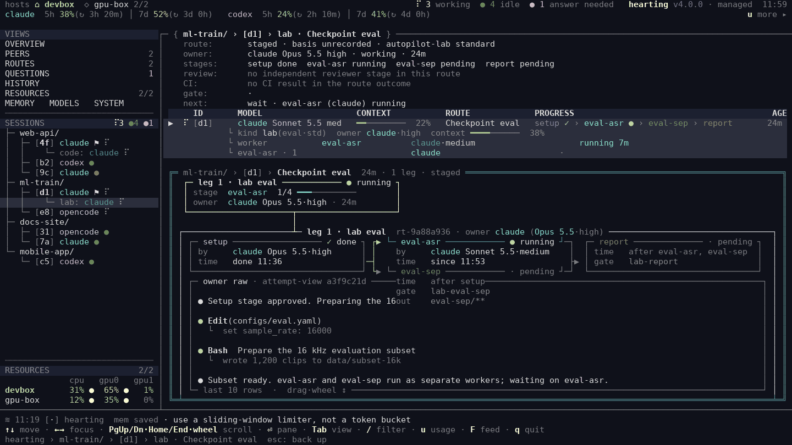

<h1 align="center">Hearting</h1>

<p align="center"><strong>One way of working for your coding agents — on Claude Code, Codex, and OpenCode.</strong></p>

<p align="center">Hearting keeps agent work on your intent: a capable model settles the plan,<br>
lower-cost workers carry it out in small checked steps, and Fleet shows every session and worker live.</p>

<p align="center">
  
  
  
  
  
</p>

<p align="center"><strong>English</strong> · <a href="README.ko.md">한국어</a></p>

<p align="center">
  <a href="#quick-start">Quick start</a> ·
  <a href="#fleet-every-agent-on-one-screen">Fleet</a> ·
  <a href="#permissions">Permissions</a> ·
  <a href="https://dmlguq456.github.io/hearting/">Landing page &amp; agent map ↗</a>
</p>

<p align="center">
  
</p>
<p align="center"><sub>Fleet's Explorer, OVERVIEW: sessions from all three runtimes grouped by project, each project's status on its own line, one session waiting for your answer, two requests mid-flight, and GPU use per host. Drawn from synthetic demo data (<a href="docs/fleet/overview.png">PNG</a>).</sub></p>

## Why Hearting

Agents differ by vendor, by model, and by what your workplace gives you, and
working without them is no longer an option. Hearting keeps the way you work
the same across them. You stay in charge, and the work holds together even
when the agent contributes little on its own.

- **Consistent work, whatever the agent.** Some agents do a lot on their own,
  some very little. Hearting confirms the direction with you before work
  starts, keeps each worker inside a bounded scope, and checks results
  independently, so the work stays tied to what you asked rather than to how
  capable the agent happens to be.
- **One way of working everywhere.** The same requests, stages, artifacts, and
  memory on Claude Code, Codex, and OpenCode — one of them or all three. Fleet
  watches all of them in one view.
- **A crutch for low-cost agents.** Hearting cannot make a weak model smarter.
  It lets one carry out your intent anyway: a capable model settles the intent
  and the plan (the *frame*), and cheaper workers carry it out in small,
  checked steps (*dispatch*).
- **Light on the agent.** Hearting is designed so that no step works only if an
  agent memorizes a long procedure; the procedure lives in the harness.
- **Existing work first.** Before planning, a cheap read-only scan lists what
  your code, earlier artifacts, memory, and git history already settled, so the
  plan starts from that instead of from what the model happens to know.

## How a request runs

Describe the outcome in your own words. There are no command names to learn,
and output follows the language of your conversation.

The fixed text Hearting prints itself, such as the route card at the start of
a request, is English by default. For Korean, declare it once: set
`"title_language": "ko"` in
`${XDG_CONFIG_HOME:-~/.config}/hearting/fleet.json`, set
`FLEET_NOW_LANG=Korean`, or set Claude Code's `language` setting to Korean.
The same declaration sets the language of Fleet's session titles.

> “Implement and test the login API, then leave a change report.”

```text
your request
  ├─ prior-art scan    what the project already has: code, artifacts, memory, git history
  ├─ frame             two capable-model legs propose a route; you confirm the direction
  └─ owner             one session keeps your request and its finish line to the end
       ├─ plan ─► plan check
       ├─ execute      a lower-cost worker; the only stage that edits source
       ├─ test, review independent checks, on another runtime when one is available
       └─ report       what changed, what was verified, what is left
                       … and Fleet shows every step above while it runs
```

How much of this runs depends on the request. A one-line answer or a typo runs
inline (`direct`). A small change gets the frame and one quick worker
(`quick`). Bigger or riskier work adds a written plan and checklist,
independent reviews, and finally adversarial or security checks
(`standard → strong → thorough → adversarial`).

Each stage runs in its own session on a model budget chosen for that stage —
`deep` for hard judgment, `balanced-deep` for important judgment, `balanced`
or `light` for planned execution, `mini` for small helper calls — and the
choice is recorded with the request. Shared contracts never name a vendor
model; you decide which real model each budget uses
([Runtimes and models](#runtimes-and-models)).

More requests that work as written:

> “Analyze this repository and write a PRD for the next feature.”

> “Review these papers and the experiment code, then build a reproduction plan.”

> “Find the earlier decision and apply this project's naming convention.”

See [capabilities/README.md](capabilities/README.md) for every entry point and
[core/WORKFLOW.md](core/WORKFLOW.md) for the routing rules.

## Fleet: every agent on one screen

When agents work in the background, the usual problem is not knowing: is it
still running, is it stuck, is it waiting for you, did it finish? Fleet
answers that in one terminal view — for every Claude Code, Codex, and OpenCode
session on the machine and every worker Hearting dispatched from them.

### What you see at a glance

<p align="center">
  
</p>
<p align="center"><sub>OVERVIEW → ROUTES → a session page → a request's raw output. Demo data.</sub></p>

Across the top: each runtime's usage-window gauges, and how many sessions are
working, idle, or waiting for you. Below it, one screen per question:

| Screen | What it tells you |
|---|---|
| **OVERVIEW** | Every session, grouped by project. Each project's line says where it stands: open requests, questions waiting for you, what is left to decide, and when it last changed. Each session shows runtime, model and effort, a short title, context left, what it is doing now, and for how long. Working, idle, and waiting-for-you have different marks. |
| **ROUTES** | Each request's stage line — `plan › execute › test › report` — with the workers running under it. |
| **QUESTIONS** | Every agent waiting for your answer or approval: which session asks, what kind of question, for which request, and since when. Older waits stay listed until you answer or the work ends; nothing is dropped for its age. Answer from Fleet when the runtime offers a reply path; otherwise Fleet points you to the session. |
| **PEERS** | Which sessions watch or steer which, and their last exchange. |
| **HISTORY** | Earlier sessions of each terminal seat, so work that continued in a new session stays traceable. |
| **RESOURCES** | CPU, memory, and per-GPU use on this machine and any configured hosts, with the session that owns each GPU process. |
| **MEMORY** | For each project: its newest decisions, open work by stage, and the latest records saved to shared memory. |
| **MODELS · SYSTEM** | Which real model each budget maps to, and the installed Hearting release. |

### Key screens

<table>
  <tr>
    <td width="50%"><br><sub><b>ROUTES</b> — each request's stage line and the worker running it.</sub></td>
    <td width="50%"><br><sub><b>QUESTIONS</b> — what is waiting for you, since when, how to answer it, and what you answered today.</sub></td>
  </tr>
  <tr>
    <td width="50%"><br><sub><b>Session page</b> — one session's state, context, current activity, route, peers, and GPU.</sub></td>
    <td width="50%"><br><sub><b>RESOURCES</b> — per-GPU use on each host and the session and command behind each process.</sub></td>
  </tr>
</table>

Select a session or a request to open its page, and from there its raw output:
tool calls and results in order, without opening the runtime itself.

<p align="center">
  
</p>
<p align="center"><sub>A lab request's page: setup done, one evaluation running, the next stages pending, and the owner's raw output underneath. Demo data.</sub></p>

The layout holds in narrow terminals too; see the
[100-column OVERVIEW](docs/fleet/narrow.png).

### Why you can trust what it shows

- **Built from the records the work itself writes.** Fleet reads the attempt
  registry the dispatcher writes and each runtime's own session state. A stalled worker
  shows up as a stalled worker, not as a parent session that went quiet, and
  orphaned rows are shown rather than dropped.
- **Unknown stays unknown.** A value Fleet could not read is shown as `?` —
  never as zero, never as success.
- **Watching changes nothing.** Observation never completes, retries, or
  cleans up work. Fleet acts only on what you select, such as answering a
  waiting question.

### Commands

```bash
fleet              # the Explorer, full screen (needs curses)
fleet --once       # one plain snapshot
fleet --json       # the same state as JSON, for scripts
fleet-monitor      # the earlier group/process view
```

`--once` and `--json` need no `curses`, so they also work on Windows under Git
Bash. Session titles follow your language; set `title_language` in
`${XDG_CONFIG_HOME:-~/.config}/hearting/fleet.json` to override it.

### Known limits

- The Explorer is the default `fleet` screen; its layout and keyboard handling
  are still being finished for v4.0.
- Fleet's screens are not in the shared text catalog yet: they stay English
  when you choose Korean, and the MEMORY screen and a few status words are
  still Korean-only. Moving them to the catalog is planned.

## Quick start

### Before you start

- **Linux or macOS.** Windows (Git Bash) is experimental.
- **Python 3.11+** (the installer checks) with PyYAML for that Python:
  `python3 -m pip install --user pyyaml`, or your OS package such as
  `python3-yaml`
- **Git**, and `curl` or `wget`.
- **At least one agent CLI, installed and signed in:** Claude Code, Codex, or
  OpenCode. Claude Code alone is enough.

<!-- TODO(public-readiness stage 5): add the tested OS × runtime matrix. -->

### Install

All three runtimes:

```bash
curl -fsSL https://github.com/dmlguq456/hearting/releases/latest/download/install.sh | sh
~/.local/bin/hearting runtime doctor --runtime all --strict
```

Claude Code only:

```bash
curl -fsSL https://github.com/dmlguq456/hearting/releases/latest/download/install.sh | sh -s -- --runtime claude
~/.local/bin/hearting runtime doctor --runtime claude --strict
```

The installer comes from the same release tag as the archive it installs and
checks that archive's SHA-256 first. It activates the full capability set as
immutable bundles for the runtimes you chose, puts `hearting`, `fleet`,
`fleet-monitor`, `mem`, and `compute-hosts` in `~/.local/bin`, and registers a
daily update check where the OS supports it. It does not touch runtime
credentials, sessions, logs, databases, or shell startup files, and it cannot
change the `PATH` of a shell that is already open: use the `~/.local/bin/...`
paths until that directory is on your `PATH`.

`runtime doctor` also names an optional piece that is missing, such as PyYAML
or herdr, and what does not work without it.

The installer prints a note about the default worker permissions. Read
[Permissions](#permissions) before your first task.

### First task

Open your agent CLI inside a Git project and ask for something small:

> “Fix the typo in the greeting output, run the existing test, and show me the diff.”

Run `fleet` in a second terminal to watch it. When it finishes you get the
change, what was run to check it, and anything left undone. For anything
beyond a one-line fix, the plan, evidence, and report stay in the project's
`.agent_reports/` folder.

When a request changes source code, Hearting usually makes the change in a
separate git worktree beside your project, `<project>-wt/<name>`, on its own
branch, so your folder, branch, and uncommitted files stay as they were. The
result then names the folder and branch that hold the change and whether it is
committed.

The [Quickstart](QUICKSTART.md) walks this task end to end with measured times,
and the [FAQ](FAQ.md) covers `PATH`, Python versions, and permissions.

<!-- TODO(public-readiness stage 1): link a published demo repository with the expected patch. -->

### Update and status

```bash
hearting runtime status --runtime all   # active release, freshness, and whether a session must restart
hearting update                         # stage and verify a release, switch, roll back on failure
hearting auto-update status
hearting config status                  # every user-owned config file and its state
```

An update does not reload instructions in sessions that are already open;
`runtime status` says whether each runtime needs a re-invocation, a new
session, or a restart. To pin a release or skip scheduled checks, use that
release's installer (replace `vX.Y.Z` with a release tag):

```bash
curl -fsSL https://github.com/dmlguq456/hearting/releases/download/vX.Y.Z/install.sh | sh -s -- --no-auto-update
```

The checksum detects transfer or asset corruption. Publisher authenticity
rests on this repository's GitHub Releases over HTTPS; there is no separate
signature.

## Permissions

**Background Claude Code workers run in bypass mode by default.** Workers that
Hearting dispatches in the background start with
`--permission-mode bypassPermissions`, because nobody is there to answer a
permission prompt and a run of denials would stop the worker mid-task.
Sessions you start yourself keep your own runtime permission settings.

To use allowlist mode instead, edit
`${XDG_CONFIG_HOME:-$HOME/.config}/hearting/dispatch-defaults.yaml`. Change
the value inside its existing `headless:` block, or add both lines if there is
no such block:

```yaml
headless:
  claude_permission_mode: allowlist
```

- Allowlist runs workers with `acceptEdits` and a bounded tool list:
  Hearting's own utilities, read-only git, test runners, and edits inside the
  worktree and the artifact root.
- Where bypass cannot apply — running as root or under sudo, or
  `permissions.disableBypassPermissionsMode` set in any Claude settings scope —
  Hearting switches to allowlist on its own and records the mode it used.
- If the file is invalid or unreadable, the shipped default, bypass, applies.
  `hearting config status` shows whether your file was read. Merge into an
  existing block; do not add a second `headless:` key or an inline `{…}`
  mapping. `DISPATCH_DEFAULTS_CONFIG` points to a different file.
- Peer sessions started with `peer-steward start` also default to bypass; set
  `child_permission_mode: inherit` under `steward:` in the same file to keep
  the parent's mode.
- This setting covers Claude Code workers only. Codex workers run in Codex's
  `workspace-write` sandbox without approval prompts; OpenCode workers start
  from your own OpenCode permission configuration.

The installer prints a short note with this default and the file path after
a Claude Code install; it asks for no input.

**Your Claude Code user rules also apply in OpenCode.** OpenCode has no
user-level rule file of its own, so when `~/.claude/rules/` (or
`$CLAUDE_CONFIG_DIR/rules/`) holds rule files, Hearting writes OpenCode's
global `AGENTS.md` as those rules followed by its own instructions, and the
install or update that starts it says so. Rules limited to certain paths are
left out, and the rule files are only read. The rule text then also reaches
the model provider your OpenCode uses. To stop it, add these two lines to the
same `dispatch-defaults.yaml`; the next install, update, or
`hearting runtime refresh --runtime opencode` puts the plain instructions back:

```yaml
user_rules:
  opencode: off
```

## Artifacts and status

Work leaves files you can read, not only a chat log. Each project has one
artifact root, `.agent_reports/`, shared by every runtime and by every git
worktree of the project:

| Folder | What lands there |
|---|---|
| `research/`, `analysis_project/` | Surveys and analyses of code, papers, or documents |
| `spec/` | The current blueprint; a revision keeps the previous version |
| `plans/<date>_<slug>/` | One work cycle: plan, checklist, dev and test logs, evidence, final report |
| `documents/`, `experiments/` | Drafted documents; experiment setups and results |

To follow a request while it runs:

```bash
hearting run attempt-view <attempt-id> --follow                    # a worker's raw output; the agent gives you the id
hearting run workflow-supervisor status --route <route-id> --json  # which stage a request is in
```

Do not delete `.agent_reports/` to unblock a task; the next stage reads the
evidence it holds. An older `.claude_reports/` folder is still read as a
legacy alias.

<!-- TODO(v4 W4): a one-page project status, refreshed when a request closes or a PR merges; describe it here once it ships. -->
<!-- TODO(public-readiness stage 4): the completion line with elapsed time and tokens; unknown values stay unknown. -->

## Memory

Decisions and conventions should outlive a session. Hearting keeps them in one
local store shared by every session, project, and runtime on the machine.

- **One store.** SQLite with full-text search, including CJK, under
  `${XDG_DATA_HOME:-~/.local/share}/hearting/memory/`.
- **The agent decides what matters.** Where the runtime supports it, each
  prompt brings a few short candidate headlines, and the agent reads a record
  in full before using it. The store itself enforces only schema, scope, and
  lifecycle.
- **History is kept.** A changed decision supersedes the old one instead of
  deleting it, and a hand-off stays pending until a later session takes it.
- **Local unless you opt in.** Sharing memory between machines is optional
  ([Shared Memory Exchange](INSTALL_LAYOUT.md#shared-memory-exchange)).
- `mem` is on your `PATH` for direct use, for example
  `mem recall "naming convention"`.

See [core/MEMORY.md](core/MEMORY.md) for the full contract.

## Runtimes and models

| Runtime | What Hearting adds through the runtime's own discovery paths |
|---|---|
| Claude Code | Skills, agents, commands, and hooks |
| Codex | Skills, custom agents, modes, and hooks |
| OpenCode | Skills, agents, commands, and local guard plugin |

Every runtime sees the full capability set. Where a runtime lacks a surface,
the installer marks it `SKIP` with a reason instead of hiding the difference.
Claude Code alone is a supported setup; with more than one runtime installed,
Hearting can place workers and independent reviews across them.

Shared contracts name budgets, not vendor models. Each runtime maps the budgets
to real models in a user-owned file,
`<runtime-home>/agent-config/models.conf`, seeded once at install and never
overwritten. This is where a cheaper model goes onto `light` work:

```bash
hearting model set codex light <model>[@effort]
hearting model get claude context-window --json
hearting model set claude context-window 800000
```

The context budget defaults to 800,000 tokens for Claude Code and OpenCode and
1,000,000 for Codex (capped at the selected model's maximum). New sessions use
changed settings; running sessions keep theirs. Details are in
[INSTALL_LAYOUT.md](INSTALL_LAYOUT.md#user-model-configuration).

## Optional features

None of these is needed for the basic workflow.

- **herdr** — a terminal pane manager. Fleet and peer sessions use it when it
  is present; without it, the related hooks exit quietly.
- **Cairn** — an optional reader for finished artifacts. When it is not set up
  it reports itself unavailable; ordinary work is unaffected.
- **Compute hosts and GPUs** — `compute-hosts` reads
  `${XDG_CONFIG_HOME:-$HOME/.config}/hearting/compute-hosts.yaml`, seeded as a
  commented template. Until you fill in a host it reports `template`, and a
  compute request without a configured host fails with a clear error. Fleet
  shows this machine's CPU and GPU use even without the file.
- **Memory exchange between machines** — see [Memory](#memory).

## What Hearting does not do

| It does not | Instead |
|---|---|
| Replace your agent CLI | Claude Code, Codex, and OpenCode stay vendor-owned; Hearting adds to them through their own discovery paths |
| Touch credentials, sessions, logs, or runtime databases | Those stay owned by each runtime |
| Edit your shell startup files | You add `~/.local/bin` to `PATH` yourself |
| Schedule GPU work or start remote agents just because it is installed | Compute runs only on a host you name |
| Send memory anywhere by default | Memory stays local until you join an exchange |
| Make a weak model smarter | It gives a weaker model a confirmed plan and small, checked steps |
| Estimate your bill | Fleet shows the usage windows and token counts the runtimes report; that is not a bill or a quota forecast |

## Develop Hearting

```bash
git clone https://github.com/dmlguq456/hearting.git ~/hearting
cd ~/hearting
./tools/install/harness.sh runtime activate --runtime all
git config core.hooksPath tools/git-hooks
```

Shared behavior starts in `core/`, `capabilities/`, and `roles/`; the three
adapters under `adapters/` are equal projections of it, and
[AGENTS.md](AGENTS.md) holds Hearting's purpose and maintenance principles. After
changing a shared definition, refresh and check every generated projection:

```bash
python3 tools/generate.py
python3 tools/generate.py --check
./tools/check-adaptation-boundary.sh
./tools/skill-conformance/check.sh
```

The `pre-push` hook runs the same projection check CI runs. Packaged
activation refuses to build from a dirty tree, so run the install lifecycle
suites from a clean checkout; `--mode linked` exists only for live debugging.

See [CONTRIBUTING.md](CONTRIBUTING.md) before opening a pull request.

## Documentation

| Purpose | Document |
|---|---|
| Purpose and maintenance principles | [AGENTS.md](AGENTS.md) |
| First task, common questions, contributing | [QUICKSTART.md](QUICKSTART.md), [FAQ.md](FAQ.md), [CONTRIBUTING.md](CONTRIBUTING.md) |
| How the parts fit together | [MANUAL.md](MANUAL.md) |
| Installation and runtime projections | [INSTALL_LAYOUT.md](INSTALL_LAYOUT.md) |
| Releases and versioning | [RELEASE_POLICY.md](RELEASE_POLICY.md) |
| Capabilities and roles | [capabilities/README.md](capabilities/README.md), [roles/README.md](roles/README.md), [roles/MODES.md](roles/MODES.md) |
| Routing and artifacts | [core/WORKFLOW.md](core/WORKFLOW.md), [core/CONVENTIONS.md](core/CONVENTIONS.md) |
| Git, worktrees, dispatch, and Fleet | [core/OPERATIONS.md](core/OPERATIONS.md) |
| Memory | [core/MEMORY.md](core/MEMORY.md) |
| Hooks and design principles | [core/HOOKS.md](core/HOOKS.md), [core/DESIGN_PRINCIPLES.md](core/DESIGN_PRINCIPLES.md) |

## License

[MIT](LICENSE)
