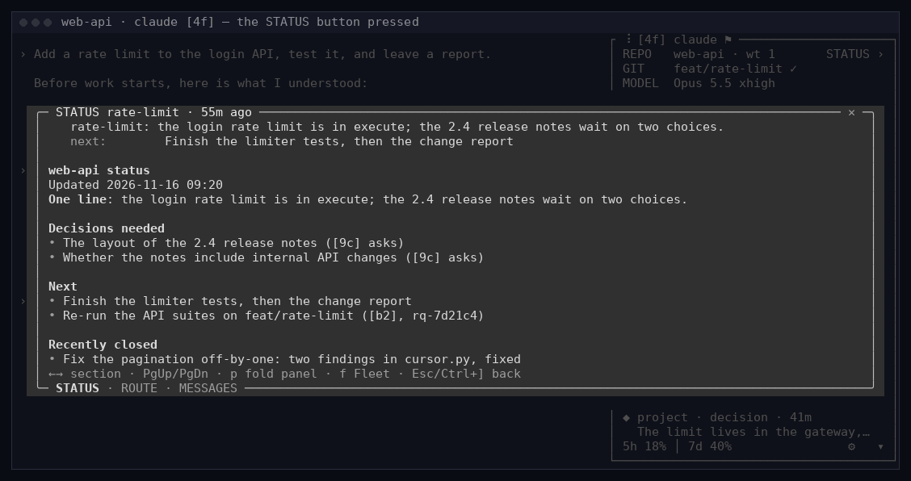
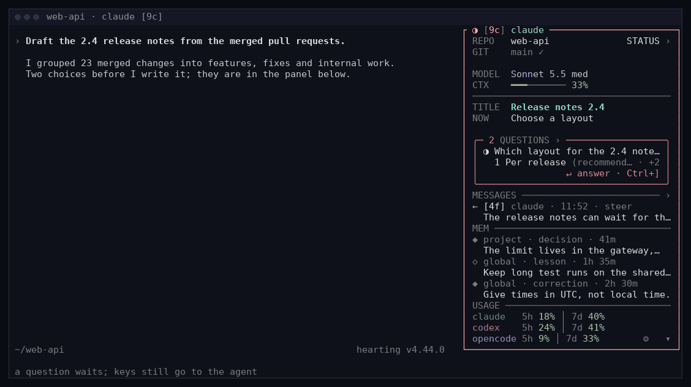
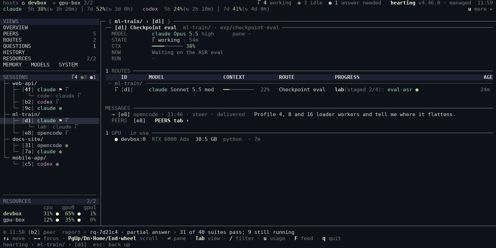
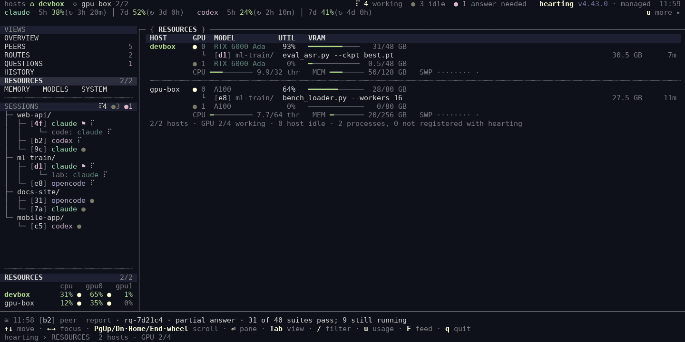
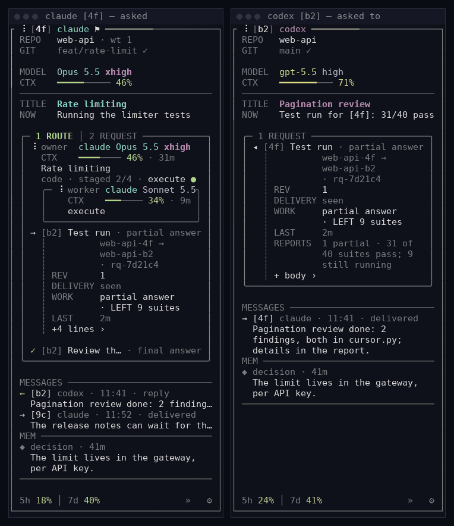

<p align="center">
  <picture>
    <source media="(prefers-color-scheme: dark)" srcset="docs/brand/hearting-mark-dark.svg">
    <source media="(prefers-color-scheme: light)" srcset="docs/brand/hearting-mark-light.svg">
    
  </picture>
</p>

<h1 align="center">Hearting</h1>

<p align="center"><strong>Supervise every coding agent from one seat — on Claude Code, Codex, and OpenCode.</strong></p>

<p align="center">Each session gets a panel with its questions, routes, other sessions, and messages; Fleet shows every session and which one needs you.<br>
A capable model settles the plan, and lower-cost workers carry it out in small, checked steps.</p>

<p align="center">
  
  
  
  
  
</p>

<p align="center"><strong>English</strong> · <a href="README.ko.md">한국어</a></p>

<p align="center">
  <a href="#quick-start">Quick start</a> ·
  <a href="#one-seat-for-every-session">One seat</a> ·
  <a href="https://dmlguq456.github.io/hearting/fleet.html">Fleet tour ↗</a> ·
  <a href="https://dmlguq456.github.io/hearting/">Website ↗</a> ·
  <a href="FAQ.md">FAQ</a>
</p>

<p align="center">
  
</p>
<p align="center"><sub>Session <code>[4f]</code> at work, with its Hearting panel on the right. Demo data; the conversation is illustrative.</sub></p>

<p align="center">
  
</p>
<p align="center"><sub>Fleet's OVERVIEW at the same moment: every session on the machine, by project.</sub></p>

<p align="center">
  
</p>
<p align="center"><sub>PEERS: which session asked, answered, or wrote to which, and when.</sub></p>

<p align="center">
  
</p>
<p align="center"><sub>ROUTES, with <code>[4f]</code>'s route opened in place: its stages and who runs each.</sub></p>

## Why Hearting

Agents differ by vendor, by model, and by what your workplace gives you, and
working without them is no longer an option. Hearting keeps the way you work
the same across them. You stay in charge, and the work holds together even
when the agent contributes little on its own.

- **Consistent work, whatever the agent.** Hearting confirms your intent with
  you before work starts, keeps each worker inside a bounded scope, and checks
  results independently, so the work stays tied to what you asked rather than
  to how capable the agent happens to be.
- **One way of working everywhere.** The same requests, stages, artifacts,
  memory, panel, and Fleet on Claude Code, Codex, and OpenCode — one of them or
  all three.
- **Everything on record, in one view.** Sessions on every runtime write to the
  same records, and each session's panel and Fleet read them: what each session
  is doing, which requests are open and at which stage, which questions wait
  for you, and what was decided or left open.
- **A crutch for low-cost agents.** Hearting cannot make a weak model smarter.
  It lets one carry out your intent anyway: a capable model settles the intent
  and the plan (the *frame*), and cheaper workers carry it out in small,
  checked steps (*dispatch*).
- **Light on the agent.** No step works only if an agent memorizes a long
  procedure; the procedure lives in the harness.
- **Existing work first.** Before planning, a cheap read-only scan lists what
  your code, earlier artifacts, memory, and git history already settled.

## One seat for every session

Every session gets a panel beside it, Fleet shows all of them at once, and
sessions hand each other work as tracked requests. All three read the same
records, so what one session's panel says is what Fleet says about it.

### The panel beside each session

New installations open a 40-column panel on the right of every new Claude Code,
Codex, and OpenCode terminal. Under the project and Git state, the model and
context, and the session's title and what it is doing now, each section keeps a
few rows: questions waiting for you, this session's routes, this project's
experiments (`LAB`), the other sessions on the machine, messages and requests,
and saved memory (`MEM`) with its scope and kind. Press a section and its whole
Fleet table opens in a popup in the middle of the window, the rest gray behind
it. A question you can answer here reads as a rose button. **Ctrl+]** always
opens a popup, that question first: answer with **Tab**, **1–9**, and
**Enter**, and the popup closes with `✓ answer sent`. In a popup **←/→** move
between sections, **f** opens Fleet in the same window, **p** folds the panel
into a strip under the agent's screen, and **Esc** or **Ctrl+]** closes it.
While the session runs the frame stays lit and a light passes over the rule
under the model; **⚙** → rule motion picks another motion or none.
`hearting session shell disable` turns the panel off for new terminals. Keys,
settings, the narrow-window layout, and per-runtime details are in
[docs/session-panel.md](docs/session-panel.md).

<p align="center">
  
</p>
<p align="center"><sub><b>A section pressed</b> — <code>[d1]</code>'s <code>LAB</code> opens Fleet's LAB table in a popup; the rest goes gray. Demo data.</sub></p>

<p align="center">
  
</p>
<p align="center"><sub><b>Answering</b> — Ctrl+] → Tab → 2 → Enter. Demo data.</sub></p>

### Fleet: every session at once

Fleet is one terminal view of every Claude Code, Codex, and OpenCode session on
the machine and every worker Hearting dispatched from them: whether each one is
running, stuck, or waiting for you. OVERVIEW, PEERS, and ROUTES are the
pictures at the top of this page.

| Screen | What it tells you |
|---|---|
| **OVERVIEW** | Every session, grouped by project, with each project's open requests, questions waiting for you, and latest result. Each session shows runtime, model, context left, what it is doing now, and its age; expand it for your last input and the messages it received. |
| **ROUTES** | Each request: who does it now and where it stands (`one-shot`, or `staged 3/7 execute ●` for one worker per stage), with the workers running under it. |
| **QUESTIONS** | Every agent waiting for your answer or approval, since when, and how to answer. Answer from Fleet when the runtime offers a reply path; otherwise Fleet points you to the session. |
| **RESOURCES** | CPU, memory, and per-GPU use on this machine and any configured hosts, with the session that owns each GPU process. |
| **PEERS** | Which session asked another for work, reported back, sent a message, or watches another, and when. |
| **Others** | HISTORY, MEMORY, MODELS · SYSTEM. Select a project for its status, open work, routes, results, and its `LAB` table. |

<table>
  <tr>
    <td width="50%"><br><sub><b>QUESTIONS</b> — what is waiting for you, since when, and how to answer it.</sub></td>
    <td width="50%"><br><sub><b>Session page</b> — state, context, current activity, route, peers, and GPU.</sub></td>
  </tr>
  <tr>
    <td colspan="2" align="center"><br><sub><b>RESOURCES</b> — per-GPU use and the session and command behind each process.</sub></td>
  </tr>
</table>

The panel and Fleet open each other: **Ctrl+]** and then **f** in a session's
window opens Fleet there, and **Ctrl+]** on a session page in Fleet opens that
exact session's panel. A waiting question can be answered from either side. The
layout holds in narrow terminals too ([100-column OVERVIEW](docs/fleet/narrow.png)).

```bash
fleet              # the Explorer, full screen (needs curses)
fleet --once       # one plain snapshot
fleet --json       # the same state as JSON, for scripts
```

**Known limits.** Fleet is not light yet. On a machine with a long work history
and many live sessions, one Explorer window used about a third of one CPU core
and about 0.8 GB of memory. A newly started window draws its first screen as
soon as the session list is read and marks the cells still loading
`details wait`.

### Sessions talk to each other

A session can hand another session work as a tracked **request**, in your own
words — “Ask session [b2] to re-run the API tests on feat/rate-limit and report
back.” The request gets a number. The other session receives one short line
and opens the body itself; it sends partial reports while the work continues
and a final report, or a rejection, when it is done, and each report wakes the
session that asked. The asker can send a new revision or cancel, and a request
follows the other session to a successor only when Hearting confirms the
handover. Both panels show the request in MESSAGES until it closes: `→` work
you handed out, `◂` work handed to you, `✓` finished; press it for its reports
and body.

<p align="center">
  
</p>
<p align="center"><sub>The same request in the MESSAGES of the session that asked (<code>[4f]</code>) and the one asked (<code>[b2]</code>). Demo data.</sub></p>

Short messages and watching work the same way: a session can send another a
note, or watch it and be woken once when it finishes, stops, or needs you
(the wake differs by runtime — see the table below).
None of this needs herdr or tmux; it runs on Hearting's own records. How fast
an idle session is reached differs by runtime (see
[Runtimes and models](#runtimes-and-models)). Fleet shows a request only as a
PEERS link (sent, reported); it has no list of session-to-session requests yet,
and you cannot send one from Fleet yet. For scripts, the commands are
`hearting run peer-steward request`, `report`, and `show`
([core/OPERATIONS.md](core/OPERATIONS.md), “Peer requests”).

### Why you can trust what it shows

- **Same records, same values.** The panel and Fleet read the attempt registry
  the dispatcher writes and each runtime's own session state. A stalled worker
  shows up as a stalled worker, not as a parent session that went quiet.
- **Unknown stays unknown.** A value that could not be read is shown as `?` —
  never as zero, never as success.
- **Watching changes nothing.** Observation never completes, retries, or
  cleans up work. The panel and Fleet act only on what you select, such as
  answering a waiting question.

## How a request runs

Describe the outcome in your own words. There are no command names to learn,
and output follows the language of your conversation.

> “Implement and test the login API, then leave a change report.”

```text
your request
  ├─ prior-art scan    what the project already has: code, artifacts, memory, git history
  ├─ frame             two capable-model legs propose a route; you are asked only if there is a choice
  └─ owner             one session keeps your request and its finish line to the end
       ├─ plan ─► plan check
       ├─ execute      a lower-cost worker; the only stage that edits source
       ├─ test, review independent checks, on another runtime when one is available
       └─ report       what changed, what was verified, what is left
                       … and the panel and Fleet show every step above while it runs
```

Before work you asked for starts, the agent shows one short card: your words
and what it understood — intent, scope, what it will not do, and when it is
done. You answer Proceed, Edit, or Stop, and those lines travel with the
request to the owner and every worker. When the two frame legs agree and leave
nothing for you to choose, work starts with a one-line notice you can correct
in your next message. When a dispatched request finishes, you get a short
summary of the intent, the result, its cost (elapsed time and session tokens),
what changed, what was checked, and what is left. When several notices arrive
together, failures and anything that needs attention come first, and normal
progress is folded into one line.

How much of this runs depends on the request. A one-line answer or a tiny
reversible fix is done right in your folder and recorded automatically. A small
change that needs a route gets the frame and one quick worker (`quick`). Bigger
or riskier work adds a written plan, independent reviews, and finally
adversarial or security checks (`standard → strong → thorough → adversarial`).
Each stage runs on a model budget chosen for it — `deep`, `balanced-deep`,
`balanced`, `light`, or `mini` — and you decide which real model each budget
uses ([Runtimes and models](#runtimes-and-models)).

The fixed text Hearting prints itself, such as the card, the summary, and the
panel's and Fleet's words, is English unless you declare Korean once
([FAQ](FAQ.md#does-the-language-setting-translate-every-label)).
See [capabilities/README.md](capabilities/README.md) for every entry point and
[core/WORKFLOW.md](core/WORKFLOW.md) for the routing rules.

## Quick start

**You need** Linux or macOS (Windows under Git Bash is experimental), Python
3.11+ with PyYAML (`python3 -m pip install --user pyyaml`, or your OS package
such as `python3-yaml`), Git, `curl` or `wget`, and at least one agent CLI,
installed and signed in: Claude Code, Codex, or OpenCode. Claude Code alone is
enough. CI checks the installation for all three on Ubuntu; macOS has not been
checked end to end.

```bash
curl -fsSL https://github.com/dmlguq456/hearting/releases/latest/download/install.sh | sh
~/.local/bin/hearting runtime doctor --runtime all --strict
```

For Claude Code only, add `-s -- --runtime claude` after `sh` and use
`--runtime claude` with `runtime doctor`. The installer comes from the same
release tag as the archive it installs and checks that archive's SHA-256
first. It puts `hearting`, `fleet`, `fleet-monitor`, `mem`, and
`compute-hosts` in `~/.local/bin` and registers a daily update check where the
OS supports it. It does not touch runtime credentials, sessions, logs,
databases, or shell startup files, so use the `~/.local/bin/...` paths until
that directory is on your `PATH`. It prints a note about the default worker
permissions; the [FAQ](FAQ.md#what-permissions-do-background-workers-have)
explains them.

### Your first five minutes

1. **Install** with the two lines above. `runtime doctor` names any optional
   piece that is missing and what does not work without it.
2. **Open your agent CLI inside a Git project.** The Hearting panel appears on
   the right of the new terminal.
3. **Ask for something small:** “Fix the typo in the greeting output, run the
   existing test, and show me the diff.” The panel's `NOW` follows the work,
   and you get the change, what was run to check it, and anything left undone.
4. **Open a second session** in another terminal, on any runtime. Press
   **Ctrl+]** and then **f** in either one: Fleet shows both, each with its
   number.
5. **Hand work across:** tell the first session “Ask session [b2] to re-run the
   tests and report back” (use the second session's number). The request shows
   in both panels, and the report wakes the first session.
6. **Find the results** in the project's `.agent_reports/` folder, or list them
   with `hearting reports`.

A tiny reversible fix like the one in step 3 is made in your own folder and
recorded automatically: the changed files, the check commands it saw run, and
the final reply. That record does not judge whether the fix or its tests
passed; set `HEARTING_AUTO_RECORD=off` to stop it. Larger changes go to a
separate git worktree beside your project, `<project>-wt/<name>`, on its own
branch, so your folder stays as it was. The [Quickstart](QUICKSTART.md) walks
this on small demo files with measured times.

### Update and status

```bash
hearting runtime status --runtime all   # active release, freshness, and whether a session must restart
hearting update                         # stage and verify a release, switch, roll back on failure
hearting config status                  # every user-owned config file and its state
hearting session shell status           # whether new terminals open with the panel
```

An update does not reload instructions in sessions that are already open;
`runtime status` says whether each runtime needs a re-invocation, a new
session, or a restart. To pin a release or skip scheduled checks, use that
release's installer with `--no-auto-update`. The checksum detects transfer or
asset corruption; publisher authenticity rests on this repository's GitHub
Releases over HTTPS, and there is no separate signature.

## Artifacts and memory

Work leaves files you can read, not only a chat log. Each project has one
artifact root, `.agent_reports/`, shared by every runtime and every git
worktree of the project. Planned work uses one cycle folder in
`campaigns/<campaign>/<cycle>/artifacts/` (`plans/`, `research/`, `spec/`,
`documents/`, `experiments/`), where a campaign groups related requests. Small
direct changes and automatic turn records go to one daily journal per campaign
(`journals/YYYY-MM-DD.md`) instead of a cycle folder; a saved record does not
mean tests passed. A campaign can keep a `STATUS.md`, which Fleet shows on the
project page. `hearting reports` lists recent results, `hearting open <number
or words>` opens one, and `hearting view` serves a local viewer. Do not delete
`.agent_reports/` to unblock a task; the next stage reads the evidence it
holds.

Decisions and conventions outlive a session in one local memory store shared by
every session, project, and runtime on the machine: SQLite with full-text
search under `${XDG_DATA_HOME:-~/.local/share}/hearting/memory/`. The agent
decides what matters and reads a record in full before using it; a changed
decision supersedes the old one instead of deleting it. Idle sessions save a
short card for the next one and compact their conversation with the runtime's
own compaction; on Claude Code the install turns off Claude's own idle
compaction (`idleCompaction: false`) so the two do not overlap, and uninstall
restores your earlier value. Memory stays local unless you join an
[exchange](INSTALL_LAYOUT.md#shared-memory-exchange); `mem recall "naming
convention"` searches it directly. Details: [core/MEMORY.md](core/MEMORY.md).

## Runtimes and models

| Runtime | What Hearting adds through the runtime's own discovery paths |
|---|---|
| Claude Code | Skills, agents, commands, and hooks |
| Codex | Skills, custom agents, modes, and hooks |
| OpenCode | Skills, agents, commands, and local guard plugin |

Every runtime sees the full capability set; where a runtime lacks a surface,
the installer marks it `SKIP` with a reason. With more than one runtime
installed, Hearting can place workers and independent reviews across them. The
panel, requests, and Fleet are the same on all three; how an idle session is
reached is not:

| | Claude Code | Codex | OpenCode |
|---|---|---|---|
| Panel | yes | yes | yes |
| A message, request, or report reaches an idle session | at once in the panel's terminal; outside it, at the session's next turn | at once, through its own thread queue | at once in the panel's terminal; outside it, at its next idle or tool callback |
| Woken when a watched session finishes or needs you | yes | where Hearting has proven its terminal; otherwise it gets a command to wait on | it gets a command to wait on |

Shared contracts name budgets, not vendor models. Each runtime maps the budgets
to real models in a user-owned file, `<runtime-home>/agent-config/models.conf`,
seeded once at install and never overwritten. This is where a cheaper model
goes onto `light` work:

```bash
hearting model set codex light <model>[@effort]
hearting model get claude context-window --json
hearting model set claude context-window 800000
```

The context budget defaults to 800,000 tokens for Claude Code and OpenCode and
1,000,000 for Codex (capped at the selected model's maximum); new sessions use
changed settings. What Hearting adds is small but not free: on Codex, three measured pairs on one
machine found the first response about 0.7 s slower and about 2.4K more input
tokens per request. Details are in
[INSTALL_LAYOUT.md](INSTALL_LAYOUT.md#user-model-configuration).

## Optional features

None of these is needed for the basic workflow.

- **herdr or tmux** — terminal pane managers. With one, Hearting can open and
  close peer windows and title panes, and question notifications reach them; a
  desktop session also gets question notifications through `notify-send`.
  Messages, requests, watching, and the panel do not need either.
- **The panel** is on by default for new installations;
  `hearting session shell disable` restores native launch behavior and
  `enable` turns it on again. Running sessions are not affected.
- **Compute hosts and GPUs** — `compute-hosts` reads
  `${XDG_CONFIG_HOME:-$HOME/.config}/hearting/compute-hosts.yaml`, seeded as a
  commented template. Fleet shows this machine's CPU and GPU use even without
  it.
- **Outside artifact tool** — finished artifacts can go to a separate tool you
  connect, such as a document reader; with none connected, that step reports
  itself unavailable.
- **Memory exchange between machines** — see [Artifacts and memory](#artifacts-and-memory).

## What Hearting does not do

| It does not | Instead |
|---|---|
| Replace your agent CLI | Claude Code, Codex, and OpenCode stay vendor-owned; Hearting adds to them through their own discovery paths |
| Touch credentials, sessions, logs, or runtime databases | Those stay owned by each runtime |
| Edit your shell startup files | You add `~/.local/bin` to `PATH` yourself |
| Schedule GPU work or start remote agents just because it is installed | Compute runs only on a host you name |
| Send memory anywhere by default | Memory stays local until you join an exchange |
| Make a weak model smarter | It gives a weaker model a confirmed plan and small, checked steps |
| Estimate your bill | The panel and Fleet show the usage windows and token counts the runtimes report; that is not a bill or a quota forecast |

## Develop Hearting

```bash
git clone https://github.com/dmlguq456/hearting.git ~/hearting
cd ~/hearting
./tools/install/harness.sh runtime activate --runtime all
git config core.hooksPath tools/git-hooks
```

Shared behavior starts in `core/`, `capabilities/`, and `roles/`; the three
adapters under `adapters/` are equal projections of it, and
[AGENTS.md](AGENTS.md) holds Hearting's purpose and maintenance principles. After
changing a shared definition, refresh and check every generated projection:

```bash
python3 tools/generate.py
python3 tools/generate.py --check
./tools/check-adaptation-boundary.sh
./tools/skill-conformance/check.sh
```

The `pre-push` hook runs the same projection check CI runs. Packaged
activation refuses to build from a dirty tree, so run the install lifecycle
suites from a clean checkout; `--mode linked` exists only for live debugging.
Read [CONTRIBUTING.md](CONTRIBUTING.md) before opening a pull request.

## Documentation

| Purpose | Document |
|---|---|
| Purpose and maintenance principles | [AGENTS.md](AGENTS.md) |
| First task, common questions, contributing | [QUICKSTART.md](QUICKSTART.md), [FAQ.md](FAQ.md), [CONTRIBUTING.md](CONTRIBUTING.md) |
| The session panel: keys, settings, layouts, per-runtime details | [docs/session-panel.md](docs/session-panel.md) |
| How the parts fit together | [MANUAL.md](MANUAL.md) |
| Installation and runtime projections | [INSTALL_LAYOUT.md](INSTALL_LAYOUT.md) |
| Releases and versioning | [RELEASE_POLICY.md](RELEASE_POLICY.md) |
| Capabilities and roles | [capabilities/README.md](capabilities/README.md), [roles/README.md](roles/README.md), [roles/MODES.md](roles/MODES.md) |
| Routing and artifacts | [core/WORKFLOW.md](core/WORKFLOW.md), [core/CONVENTIONS.md](core/CONVENTIONS.md) |
| Git, worktrees, dispatch, Fleet, and peer requests | [core/OPERATIONS.md](core/OPERATIONS.md) |
| Memory | [core/MEMORY.md](core/MEMORY.md) |
| Hooks and design principles | [core/HOOKS.md](core/HOOKS.md), [core/DESIGN_PRINCIPLES.md](core/DESIGN_PRINCIPLES.md) |

## License

[MIT](LICENSE)
