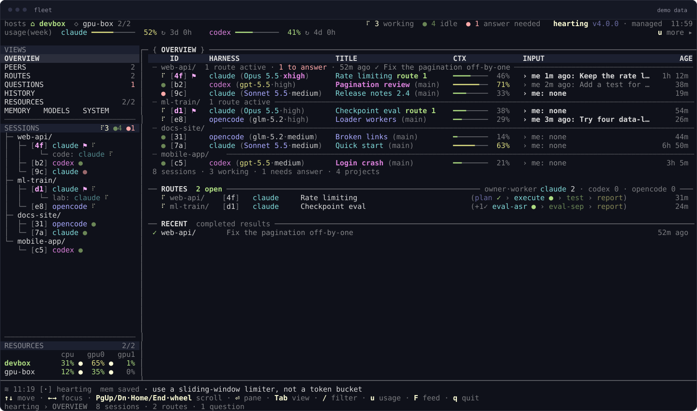
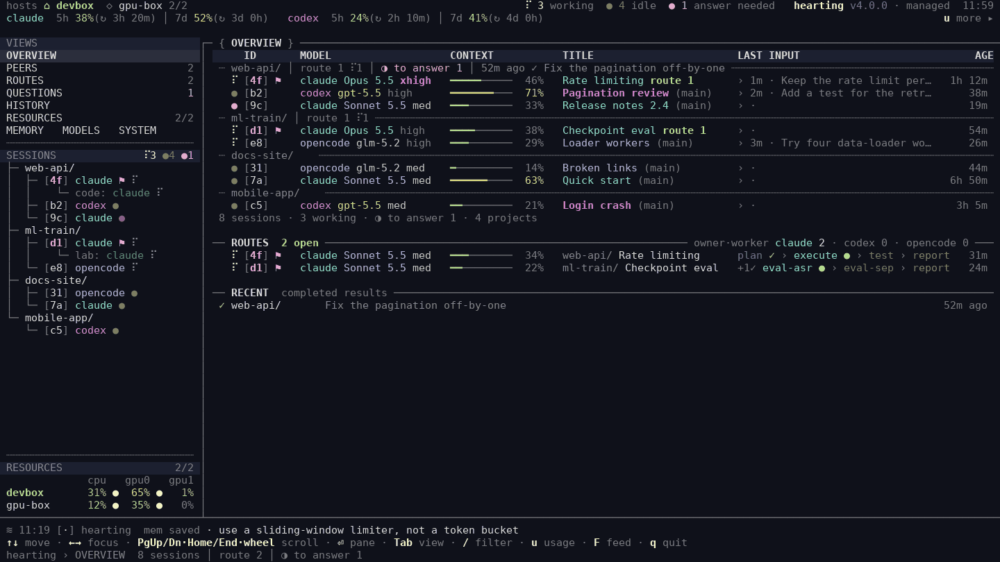
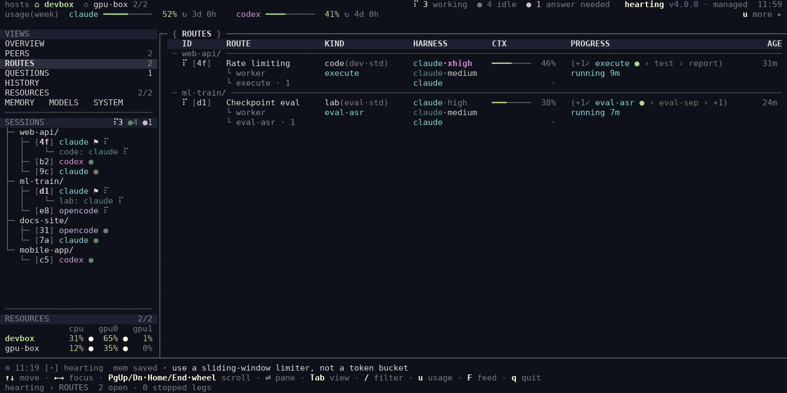
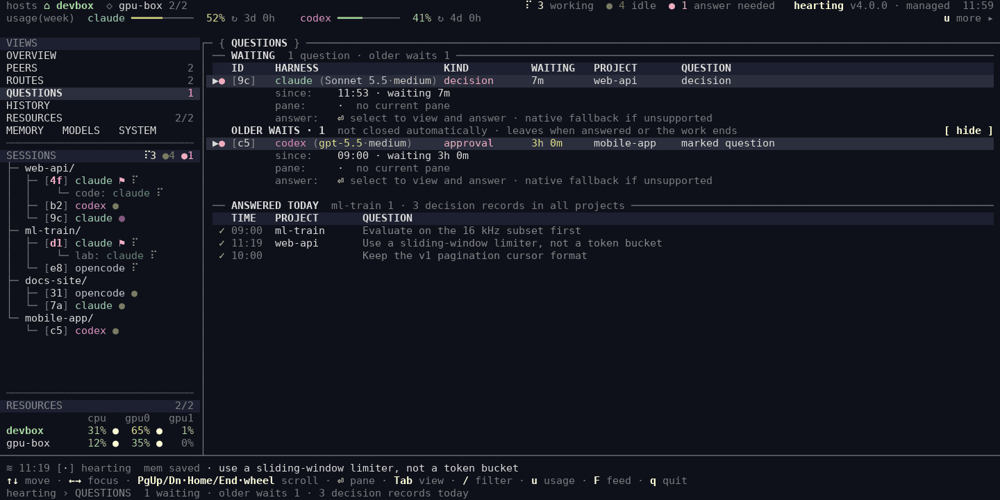
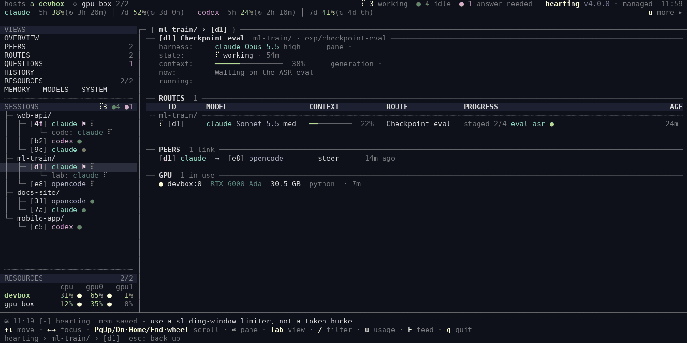
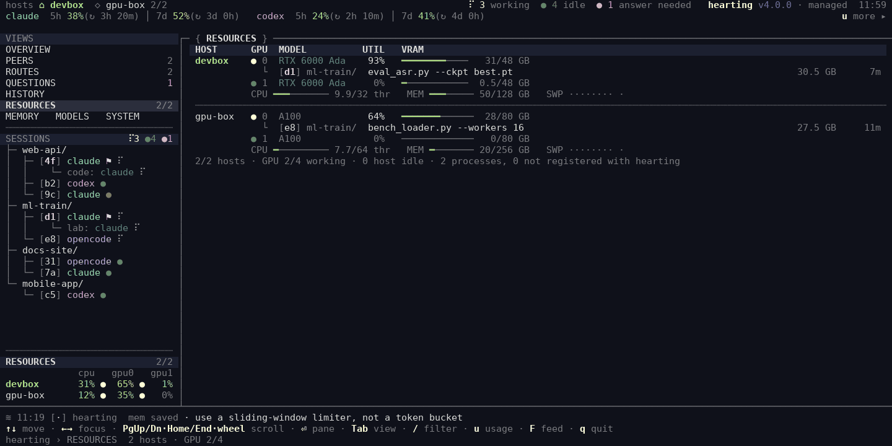

<h1 align="center">Hearting</h1>

<p align="center"><strong>One way of working for your coding agents — on Claude Code, Codex, and OpenCode.</strong></p>

<p align="center">Hearting keeps agent work on your intent: a capable model settles the plan,<br>
lower-cost workers carry it out in small checked steps, and Fleet shows every session and worker live.</p>

<p align="center">
  
  
  
  
  
</p>

<p align="center"><strong>English</strong> · <a href="README.ko.md">한국어</a></p>

<p align="center">
  <a href="#quick-start">Quick start</a> ·
  <a href="#fleet-every-agent-on-one-screen">Fleet</a> ·
  <a href="FAQ.md">FAQ</a> ·
  <a href="https://dmlguq456.github.io/hearting/fleet.html">Fleet tour ↗</a> ·
  <a href="https://dmlguq456.github.io/hearting/">Website ↗</a>
</p>

<p align="center">
  
</p>
<p align="center"><sub>Fleet's Explorer, OVERVIEW: sessions from all three runtimes grouped by project, each project's status on its own line, one session waiting for your answer, two requests mid-flight, and GPU use per host. Drawn from synthetic demo data (<a href="docs/fleet/overview.png">PNG</a>).</sub></p>
<p align="center"><a href="https://dmlguq456.github.io/hearting/fleet.html"><strong>Take the Fleet tour →</strong></a> — every screen at full size, and why you can trust it.</p>

## Why Hearting

Agents differ by vendor, by model, and by what your workplace gives you, and
working without them is no longer an option. Hearting keeps the way you work
the same across them. You stay in charge, and the work holds together even
when the agent contributes little on its own.

- **Consistent work, whatever the agent.** Some agents do a lot on their own,
  some very little. Hearting confirms your intent with you before work
  starts, keeps each worker inside a bounded scope, and checks results
  independently, so the work stays tied to what you asked rather than to how
  capable the agent happens to be.
- **One way of working everywhere.** The same requests, stages, artifacts, and
  memory on Claude Code, Codex, and OpenCode — one of them or all three.
- **Everything on record, in one view.** Sessions on every runtime write to the
  same records: what each session is doing, where each project stands, which
  requests are open and at which stage, which questions wait for your answer,
  and what was decided or left open. Fleet shows all of it on one terminal
  screen, with each terminal's earlier sessions and the GPU each session holds,
  and you can answer a waiting question from there when the runtime allows it.
- **A crutch for low-cost agents.** Hearting cannot make a weak model smarter.
  It lets one carry out your intent anyway: a capable model settles the intent
  and the plan (the *frame*), and cheaper workers carry it out in small,
  checked steps (*dispatch*).
- **Light on the agent.** Hearting is designed so that no step works only if an
  agent memorizes a long procedure; the procedure lives in the harness.
- **Existing work first.** Before planning, a cheap read-only scan lists what
  your code, earlier artifacts, memory, and git history already settled, so the
  plan starts from that instead of from what the model happens to know.

## How a request runs

Describe the outcome in your own words. There are no command names to learn,
and output follows the language of your conversation.

The fixed text Hearting prints itself, such as the route card at the start of
a request, the one-line direction notice, and the summary at its end, is
English by default. For Korean, declare it once: set
`"title_language": "ko"` in
`${XDG_CONFIG_HOME:-~/.config}/hearting/fleet.json`, set
`FLEET_NOW_LANG=Korean`, or set Claude Code's `language` setting to Korean.
The same declaration sets the language of Fleet's screens and session titles.

> “Implement and test the login API, then leave a change report.”

```text
your request
  ├─ prior-art scan    what the project already has: code, artifacts, memory, git history
  ├─ frame             two capable-model legs propose a route; you are asked only if there is a choice
  └─ owner             one session keeps your request and its finish line to the end
       ├─ plan ─► plan check
       ├─ execute      a lower-cost worker; the only stage that edits source
       ├─ test, review independent checks, on another runtime when one is available
       └─ report       what changed, what was verified, what is left
                       … and Fleet shows every step above while it runs
```

Before work you asked for starts, the agent shows one short card in your
language: your words and what it understood — intent, scope, what it will not
do, and when it is done. You answer Proceed, Edit, or Stop, and those lines
travel with the request to the owner and every worker. When the two frame legs
agree and leave nothing for you to choose, work starts without another
question and you get a one-line notice you can correct in your next message.
When a dispatched request finishes, the runtime writes a short summary of the
intent, the result, its cost (elapsed time and session tokens), what changed,
what was checked, and what is left.

How much of this runs depends on the request. A one-line answer or a tiny reversible
fix is done right in your folder and recorded automatically. A small change that
needs a route gets the frame and one quick worker (`quick`). Bigger or riskier work adds a written plan and checklist,
independent reviews, and finally adversarial or security checks
(`standard → strong → thorough → adversarial`).

Each stage runs in its own session on a model budget chosen for that stage —
`deep` for hard judgment, `balanced-deep` for important judgment, `balanced`
or `light` for planned execution, `mini` for small helper calls — and the
choice is recorded with the request. Shared contracts never name a vendor
model; you decide which real model each budget uses
([Runtimes and models](#runtimes-and-models)).

More requests that work as written:

> “Analyze this repository and write a PRD for the next feature.”

> “Find the earlier decision and apply this project's naming convention.”

See [capabilities/README.md](capabilities/README.md) for every entry point and
[core/WORKFLOW.md](core/WORKFLOW.md) for the routing rules.

## Fleet: every agent on one screen

When agents work in the background, you cannot tell whether one is still
running, stuck, or waiting for you. Fleet answers in one terminal view, for every
Claude Code, Codex, and OpenCode session on the machine and every worker
Hearting dispatched from them.

**[Take the Fleet tour →](https://dmlguq456.github.io/hearting/fleet.html)**
Every screen at full size, with a line on what each one tells you.

### What you see at a glance

<p align="center">
  
</p>
<p align="center"><sub>OVERVIEW → ROUTES → a session page → a request's raw output. Demo data.</sub></p>

Across the top: each runtime's usage-window gauges, and how many sessions are
working, idle, or waiting for you. Below it, one screen per question:

| Screen | What it tells you |
|---|---|
| **OVERVIEW** | Every session, grouped by project. Each project's line says where it stands: open requests, questions waiting for you, what is left to decide, and when it last changed. Each session shows runtime, model, context left, what it is doing now and its age. Expand a session for your last input and the first lines of received peer/runtime messages, without notification wrappers. |
| **ROUTES** | Each request: who does it now, its kind and where it stands — `one-shot`, or `staged 3/7 execute ●` for one worker per stage — with the workers running under it; open it for its stages. |
| **QUESTIONS** | Every agent waiting for your answer or approval: which session, what kind, for which request, and since when. Older waits stay listed until you answer or the work ends. Answer from Fleet when the runtime offers a reply path; otherwise Fleet points you to the session. |
| **RESOURCES** | CPU, memory, and per-GPU use on this machine and any configured hosts, with the session that owns each GPU process. |
| **Others** | PEERS (which sessions watch or steer which), HISTORY (earlier sessions of each terminal seat), MEMORY (each project's newest decisions and open work), MODELS · SYSTEM (which real model each budget maps to, and the installed release). |

NOW is what the session is doing now (`·` when nothing is observed). Expand the row for LAST INPUT and RECEIVED: LAST INPUT uses `› 1m · …` for your last confirmed input, `› ?` means the text cannot be confirmed, including older inputs whose first line was not kept or sessions with no readable input record, and `› ·` means no human input was recorded.

Select a project in SESSIONS for its campaign status, backlog and work in progress,
open requests and stages, completed results, recent small work records, and sessions.
Open work uses the same records as MEMORY; saving a memory does not count as completing
a task. Select a session to open its page, or expand its row in OVERVIEW.

### Optional session panel

New installations enable a common status area and a HEARTING work panel
for new Claude, Codex and OpenCode terminals. Updates preserve existing choices,
including older installations without a shell policy. `hearting session shell
enable` enables it explicitly;
`hearting session shell status` reports the choice and `hearting session shell
disable` restores native launch behavior. Existing sessions keep running.

Claude shows the same status area inside the panel as Codex and OpenCode; while
the panel shows it, Claude's own statusline row below becomes a notice row that
stays empty unless you owe an answer, a warning applies or news just arrived.
The full statusline returns whenever the panel is hidden.
The panel's top border names the session as Fleet's row does (state glyph,
session number, harness, and `⚑` for a steward), and its frame takes that
state's color the moment the native screen changes (running, waiting; idle stays
neutral); a failed route colors only its own route box. Below the model and
context, a thin rule parts this session's title and what it is doing now. Its
background stays neutral.
Below the route and any question, the panel always shows the rest of the
statusline: folder, title, branch and Git state, usage and running jobs, then
messages, as rows allow. Click a route for its stages and
result. Press **Ctrl+]** to focus it: answer
an existing question, inspect routes/peers/work, or open Fleet with **f**.
Escape or **Ctrl+]** returns to native typing; ordinary keys stay native until
you focus the block. The question-first bottom shows the current question and
choices before focus. Use **Tab** to move between questions, **1–9** to choose,
**t** for text (including pasted text), and **Enter** after every form field is
answered. Choices and drafts survive question navigation. A transport receipt
is shown separately from proved consumption; expired or cancelled questions
cannot be submitted. Focused **↑/↓** scrolls long question content, and an explicit
count marks hidden lines. Empty question sections disappear.
Fleet can open that exact session's panel too. Peer wake works
without Herdr; Codex keeps its native queue. Native context remains as a fallback
where independent telemetry cannot provide it. Herdr, cmux and tmux remain optional.

Wrapped Codex preserves its native shared-daemon startup. The shell hides the
footer's thread ID (it stays on the inner screen for identification; a Codex
window without the shell still shows it), and the rest of that row can yield
duplicate paint to the common area.
Custom, clipped or uncertain rows remain visible. Answers retain the existing
queue and consumption receipts; an unproved native target stays pending.

**⚙ Settings** (the gear at the right end of the panel's last row) previews
placement, panel position (right or left), width, narrow-window behavior,
bottom height, auxiliary detail, theme (terminal, light terminal or
monochrome) and shade (none, light or medium); the defaults keep the original
look. Use the value arrows or keyboard arrows, then Apply; Cancel restores
the previous view, and Defaults previews the defaults. Drag the side boundary
to resize and save it. Only the existing Hearting `session-shell.json` is saved,
with a byte-for-byte backup; native model and permission settings are untouched.
The default is a 40-column side panel. **»** beside the gear folds it into a
eight-cell strip (state, session number, route count, answer waits) and gives
the native area the freed columns; a press on the strip opens it again. Where
the open panel would leave the native area under 80 columns (a 40-column panel
in a terminal under 122 columns) it folds by itself and opens again with room;
a choice made by hand wins at that width. The bottom layout folds to one row
(**▾** / **▴**). Existing explicit layout choices are retained. OpenCode uses
the same panel and settings; its own sidebar is hidden in the shell window
(OpenCode's toggle still opens it), with Context in its footer and its MCP
server count in the panel. Installation affects new wrapped terminals;
existing running hosts are not replaced.

Codex context keeps the latest server-reported usage. A separate `compaction
imminent` label appears only when the exact session's current native diagnostic
supports it; detail separates server usage, native estimate, limit and time.
Unavailable or stale diagnostic data stays unknown. The 500K/700K preservation
notices do not guarantee remaining time before native compaction.

### Key screens

<table>
  <tr>
    <td width="50%"><br><sub><b>ROUTES</b> — each request's stage line and the worker running it.</sub></td>
    <td width="50%"><br><sub><b>QUESTIONS</b> — what is waiting for you, since when, how to answer it, and what you answered today.</sub></td>
  </tr>
  <tr>
    <td width="50%"><br><sub><b>Session page</b> — one session's state, context, current activity, route, peers, and GPU.</sub></td>
    <td width="50%"><br><sub><b>RESOURCES</b> — per-GPU use on each host and the session and command behind each process.</sub></td>
  </tr>
</table>

Select a session or a request to open its page, and from there its raw output:
tool calls and results in order, without opening the runtime itself. The layout
holds in narrow terminals too; see the [100-column OVERVIEW](docs/fleet/narrow.png).

### Why you can trust what it shows

- **Built from the records the work itself writes.** Fleet reads the attempt
  registry the dispatcher writes and each runtime's own session state. A stalled worker
  shows up as a stalled worker, not as a parent session that went quiet, and
  orphaned rows are shown rather than dropped.
- **Unknown stays unknown.** A value Fleet could not read is shown as `?` —
  never as zero, never as success.
- **Watching changes nothing.** Observation never completes, retries, or
  cleans up work. Fleet acts only on what you select, such as answering a
  waiting question.

### Commands

```bash
fleet              # the Explorer, full screen (needs curses)
fleet --once       # one plain snapshot
fleet --json       # the same state as JSON, for scripts
fleet-monitor      # the earlier group/process view
```

`--once` and `--json` need no `curses`, so they also work on Windows under Git
Bash. Session titles follow your language; set `title_language` in
`${XDG_CONFIG_HOME:-~/.config}/hearting/fleet.json` to override it.

### Known limits

Fleet is not light yet. On a machine with a long work history and many live
sessions, one Explorer window used about a third of one CPU core and about
0.8 GB of memory, and drew its first full screen in about 6 seconds. Lowering
its CPU use continues in v4.x.

## Quick start

### Before you start

- **Linux or macOS.** Windows (Git Bash) is experimental.
- **Python 3.11+** (the installer checks) with PyYAML for that Python:
  `python3 -m pip install --user pyyaml`, or your OS package such as
  `python3-yaml`
- **Git**, and `curl` or `wget`.
- **At least one agent CLI, installed and signed in:** Claude Code, Codex, or
  OpenCode. Claude Code alone is enough.

Tested so far: CI checks the installation for Claude Code, Codex, and OpenCode
on Ubuntu, and the measured runs in [QUICKSTART.md](QUICKSTART.md) used Linux.
macOS has not been checked end to end, and Windows (Git Bash) is experimental.

### Install

All three runtimes:

```bash
curl -fsSL https://github.com/dmlguq456/hearting/releases/latest/download/install.sh | sh
~/.local/bin/hearting runtime doctor --runtime all --strict
```

Claude Code only:

```bash
curl -fsSL https://github.com/dmlguq456/hearting/releases/latest/download/install.sh | sh -s -- --runtime claude
~/.local/bin/hearting runtime doctor --runtime claude --strict
```

The installer comes from the same release tag as the archive it installs and
checks that archive's SHA-256 first. It activates the full capability set as
immutable bundles for the runtimes you chose, puts `hearting`, `fleet`,
`fleet-monitor`, `mem`, and `compute-hosts` in `~/.local/bin`, and registers a
daily update check where the OS supports it. It does not touch runtime
credentials, sessions, logs, databases, or shell startup files, and it cannot
change the `PATH` of a shell that is already open: use the `~/.local/bin/...`
paths until that directory is on your `PATH`.

`runtime doctor` also names an optional piece that is missing, such as PyYAML
or herdr, and what does not work without it.

The installer prints a note about the default worker permissions. The
[FAQ](FAQ.md#what-permissions-do-background-workers-have) explains them and how
to change them.

### First task

Open your agent CLI inside a Git project and ask for something small:

> “Fix the typo in the greeting output, run the existing test, and show me the diff.”

Run `fleet` in a second terminal to watch it. When it finishes you get the
change, what was run to check it, and anything left undone. For anything
beyond a one-line fix, the plan, evidence, and report stay in the project's
`.agent_reports/` folder.

A tiny reversible fix like this one is made right in your project folder, and
Hearting records it automatically: the changed files, the check commands it saw
run, and the final reply. There is nothing to start or finish, and no model is
called. When a request needs more, Hearting changes source in a separate git
worktree beside your project, `<project>-wt/<name>`, on its own branch, so your
folder, branch, and uncommitted files stay as they were; the result names the
folder, the branch, and whether it is committed. The automatic record saves what
happened. It does not judge whether the fix or its tests passed. Set
`HEARTING_AUTO_RECORD=off` to stop it.

The [Quickstart](QUICKSTART.md) walks a first task end to end on small demo
files, with the expected change and measured times. The [FAQ](FAQ.md) covers
`PATH`, Python versions, and permissions.

### Update and status

```bash
hearting runtime status --runtime all   # active release, freshness, and whether a session must restart
hearting update                         # stage and verify a release, switch, roll back on failure
hearting auto-update status
hearting config status                  # every user-owned config file and its state
```

An update does not reload instructions in sessions that are already open;
`runtime status` says whether each runtime needs a re-invocation, a new
session, or a restart. To pin a release or skip scheduled checks, use that
release's installer (replace `vX.Y.Z` with a release tag):

```bash
curl -fsSL https://github.com/dmlguq456/hearting/releases/download/vX.Y.Z/install.sh | sh -s -- --no-auto-update
```

The checksum detects transfer or asset corruption. Publisher authenticity
rests on this repository's GitHub Releases over HTTPS; there is no separate
signature.

## Artifacts and status

Work leaves files you can read, not only a chat log. Each project has one
artifact root, `.agent_reports/`, shared by every runtime and by every git
worktree of the project. Planned work uses one work cycle in
`campaigns/<campaign>/<cycle>/artifacts/`, where a campaign groups related
requests (a new project starts one named after its folder):

| Folder in a cycle's `artifacts/` | What lands there |
|---|---|
| `plans/` | Plan, checklist, dev and test logs, evidence, final report |
| `research/`, `analysis_project/`, `analysis/` | Surveys and analyses of code, papers, or documents |
| `spec/` | Blueprint components; the current revision is shared under `.agent_reports/shared/spec/`, and a revision keeps the previous one |
| `documents/`, `experiments/` | Drafted documents; experiment setups and results |

A campaign can keep a status page, `STATUS.md` directly in its folder;
Hearting never creates it. Fleet prefers campaign status pages and falls back
to older cycle or research status documents. The project page shows up to three
campaign summaries; OVERVIEW keeps the project's one-line summary.

The root's `README.md` (open `index.html` in a browser) collects the most recent
results and campaigns with relative links, and Hearting rewrites it at every
publish. `hearting reports` prints the same list, and `hearting open <number or
words>` opens one result.
Optional: run `hearting view` for a local viewer (Ctrl-C to stop); `hearting open` shows its URL while it runs on the default port 8765. If that port is occupied, use `hearting view --port 0` for a free port or `--port 8766` to choose one, then open the printed URL.

To follow a request while it runs:

```bash
hearting run attempt-view <attempt-id> --follow                    # a worker's raw output; the agent gives you the id
hearting run workflow-supervisor status --route <route-id> --json  # which stage a request is in
```

Do not delete `.agent_reports/` to unblock a task; the next stage reads the
evidence it holds. An older `.claude_reports/` folder is still read as a
legacy alias.

## Memory

Decisions and conventions should outlive a session. Hearting keeps them in one
local store shared by every session, project, and runtime on the machine.

- **One store.** SQLite with full-text search, including CJK, under
  `${XDG_DATA_HOME:-~/.local/share}/hearting/memory/`.
- **The agent decides what matters.** Where the runtime supports it, each
  prompt brings a few short candidate headlines, and the agent reads a record
  in full before using it. The store itself enforces only schema, scope, and
  lifecycle.
- **History is kept.** A changed decision supersedes the old one instead of
  deleting it, and a hand-off stays pending until a later session takes it.
- **Idle sessions tidy themselves.** Once per stretch of your work, an idle
  session saves a short session card for the next one and then compacts its
  conversation with the runtime's own compaction, the same way on all three
  runtimes. The window is not cleared and its scrollback stays. On Claude Code
  the install turns off Claude's own idle compaction (`idleCompaction: false`)
  so the two do not overlap; uninstall restores your earlier value.
- **Local unless you opt in.** Sharing memory between machines is optional
  ([Shared Memory Exchange](INSTALL_LAYOUT.md#shared-memory-exchange)).
- `mem` is on your `PATH` for direct use, for example
  `mem recall "naming convention"`.

See [core/MEMORY.md](core/MEMORY.md) for the full contract.

## Runtimes and models

| Runtime | What Hearting adds through the runtime's own discovery paths |
|---|---|
| Claude Code | Skills, agents, commands, and hooks |
| Codex | Skills, custom agents, modes, and hooks |
| OpenCode | Skills, agents, commands, and local guard plugin |

Every runtime sees the full capability set. Where a runtime lacks a surface,
the installer marks it `SKIP` with a reason instead of hiding the difference.
Claude Code alone is a supported setup; with more than one runtime installed,
Hearting can place workers and independent reviews across them. What Hearting
adds is small but not free: on Codex, three measured pairs on one machine found
the first response about 0.7 s slower than without Hearting and about 2.4K more
input tokens per request; a small two-turn bug fix took about as long either
way (38 s with Hearting, 39 s without).

Shared contracts name budgets, not vendor models. Each runtime maps the budgets
to real models in a user-owned file,
`<runtime-home>/agent-config/models.conf`, seeded once at install and never
overwritten. This is where a cheaper model goes onto `light` work:

```bash
hearting model set codex light <model>[@effort]
hearting model get claude context-window --json
hearting model set claude context-window 800000
```

The context budget defaults to 800,000 tokens for Claude Code and OpenCode and
1,000,000 for Codex (capped at the selected model's maximum). New sessions use
changed settings; running sessions keep theirs. Details are in
[INSTALL_LAYOUT.md](INSTALL_LAYOUT.md#user-model-configuration).

## Optional features

None of these is needed for the basic workflow.

- **herdr or tmux** — terminal pane managers. Peer windows, pane titles, peer
  delivery, automatic `/clear`, and question notifications use herdr when it is
  present, or tmux when you work inside tmux; a desktop session also gets
  question notifications through `notify-send`. Without either, these are off,
  the related hooks exit quietly, and `hearting runtime doctor` says what is
  off.
- **Outside artifact tool** — optionally, Hearting can send finished artifacts
  to a separate tool you connect, such as a document reader or notes app. With
  none connected, that step reports itself unavailable; ordinary work is
  unaffected.
- **Compute hosts and GPUs** — `compute-hosts` reads
  `${XDG_CONFIG_HOME:-$HOME/.config}/hearting/compute-hosts.yaml`, seeded as a
  commented template. Until you fill in a host it reports `template`, and a
  compute request without a configured host fails with a clear error. Fleet
  shows this machine's CPU and GPU use even without the file.
- **Memory exchange between machines** — see [Memory](#memory).

## What Hearting does not do

| It does not | Instead |
|---|---|
| Replace your agent CLI | Claude Code, Codex, and OpenCode stay vendor-owned; Hearting adds to them through their own discovery paths |
| Touch credentials, sessions, logs, or runtime databases | Those stay owned by each runtime |
| Edit your shell startup files | You add `~/.local/bin` to `PATH` yourself |
| Schedule GPU work or start remote agents just because it is installed | Compute runs only on a host you name |
| Send memory anywhere by default | Memory stays local until you join an exchange |
| Make a weak model smarter | It gives a weaker model a confirmed plan and small, checked steps |
| Estimate your bill | Fleet shows the usage windows and token counts the runtimes report; that is not a bill or a quota forecast |

## Develop Hearting

```bash
git clone https://github.com/dmlguq456/hearting.git ~/hearting
cd ~/hearting
./tools/install/harness.sh runtime activate --runtime all
git config core.hooksPath tools/git-hooks
```

Shared behavior starts in `core/`, `capabilities/`, and `roles/`; the three
adapters under `adapters/` are equal projections of it, and
[AGENTS.md](AGENTS.md) holds Hearting's purpose and maintenance principles. After
changing a shared definition, refresh and check every generated projection:

```bash
python3 tools/generate.py
python3 tools/generate.py --check
./tools/check-adaptation-boundary.sh
./tools/skill-conformance/check.sh
```

The `pre-push` hook runs the same projection check CI runs. Packaged
activation refuses to build from a dirty tree, so run the install lifecycle
suites from a clean checkout; `--mode linked` exists only for live debugging.

Read [CONTRIBUTING.md](CONTRIBUTING.md) before opening a pull request.

## Documentation

| Purpose | Document |
|---|---|
| Purpose and maintenance principles | [AGENTS.md](AGENTS.md) |
| First task, common questions, contributing | [QUICKSTART.md](QUICKSTART.md), [FAQ.md](FAQ.md), [CONTRIBUTING.md](CONTRIBUTING.md) |
| How the parts fit together | [MANUAL.md](MANUAL.md) |
| Installation and runtime projections | [INSTALL_LAYOUT.md](INSTALL_LAYOUT.md) |
| Releases and versioning | [RELEASE_POLICY.md](RELEASE_POLICY.md) |
| Capabilities and roles | [capabilities/README.md](capabilities/README.md), [roles/README.md](roles/README.md), [roles/MODES.md](roles/MODES.md) |
| Routing and artifacts | [core/WORKFLOW.md](core/WORKFLOW.md), [core/CONVENTIONS.md](core/CONVENTIONS.md) |
| Git, worktrees, dispatch, and Fleet | [core/OPERATIONS.md](core/OPERATIONS.md) |
| Memory | [core/MEMORY.md](core/MEMORY.md) |
| Hooks and design principles | [core/HOOKS.md](core/HOOKS.md), [core/DESIGN_PRINCIPLES.md](core/DESIGN_PRINCIPLES.md) |

## License

[MIT](LICENSE)

Small direct changes and automatic turn records use one campaign daily journal
(`journals/YYYY-MM-DD.md`) instead of creating a cycle folder. Results remain
at their project locations; journal entries retain versions, checks and evidence.
A saved record does not mean tests passed. Existing cycle records stay readable.
`hearting run artifact-journal dry-run --artifact-root <root>` previews eligible
old small direct cycles. Explicit `apply --cycle <id>` backs them up before
consolidation; `restore --cycle <id>` resumes interrupted restores and preserves
later records. Planned, live, ambiguous and unsupported cycles are skipped.
