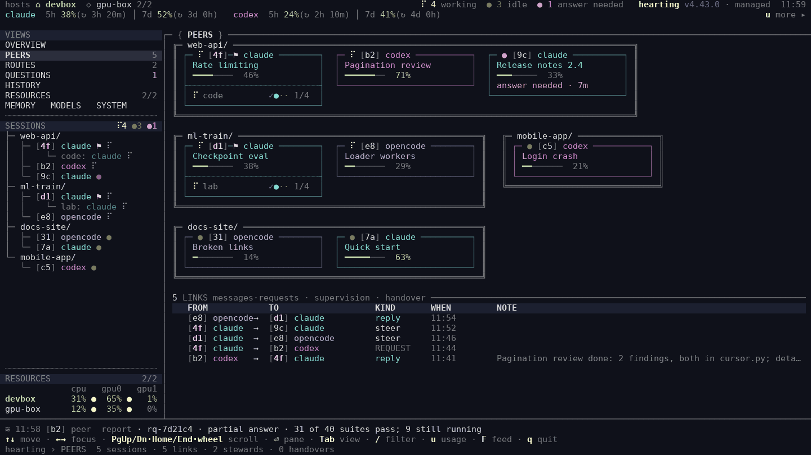
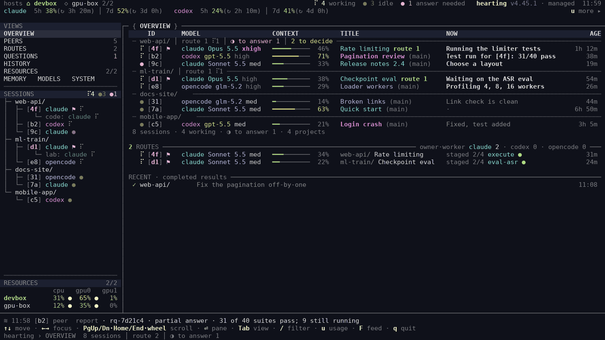
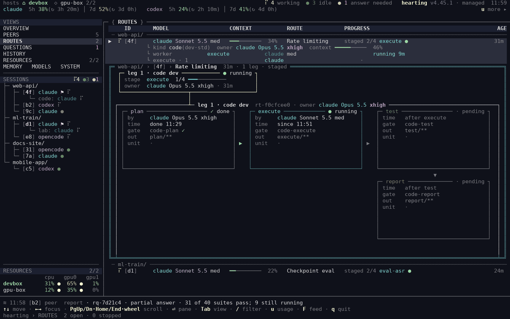
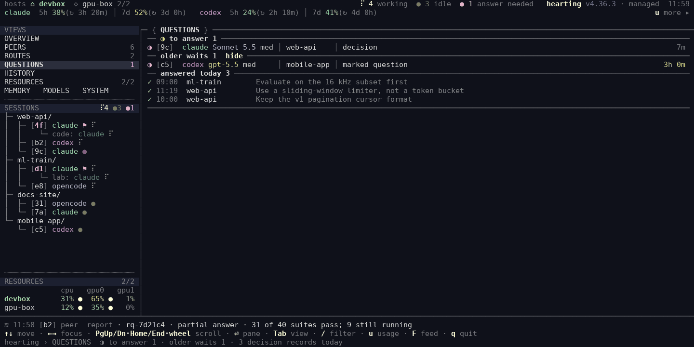

<p align="center">
  <picture>
    <source media="(prefers-color-scheme: dark)" srcset="docs/brand/hearting-mark-dark.svg">
    <source media="(prefers-color-scheme: light)" srcset="docs/brand/hearting-mark-light.svg">
    
  </picture>
</p>

<h1 align="center">Hearting</h1>

<p align="center"><strong>Different agents. A consistent way of working.</strong></p>

<p align="center">
<strong>Your way.</strong> Before work you ask for starts it confirms what you meant. What you corrected and decided is remembered and offered to your next sessions, on any of the three agents (Claude Code, Codex, OpenCode).<br>
<strong>The same everywhere.</strong> Hearting is a layer on top of all three, so the work runs with the same requests, stages, and checks.<br>
<strong>Across sessions, in view.</strong> Sessions on Claude Code, Codex, and OpenCode hand work to each other, and any session can start workers on any of them. Every step shows in the panel and in Fleet (a terminal view of all your sessions), so you can correct it at any point.<br>
<strong>Sound fundamentals, your own way.</strong> Hearting holds to the fundamentals each field agrees on and leaves the rest to you.
</p>

<p align="center">
  
  
  
  
  
</p>

<p align="center"><strong>English</strong> · <a href="README.ko.md">한국어</a></p>

<p align="center">
  <a href="#quick-start">Quick start</a> ·
  <a href="#one-seat-for-every-session">One seat</a> ·
  <a href="https://dmlguq456.github.io/hearting/fleet.html">Fleet tour ↗</a> ·
  <a href="https://dmlguq456.github.io/hearting/">Website ↗</a> ·
  <a href="docs/FAQ.md">FAQ</a>
</p>

<p align="center">
  
</p>
<p align="center"><sub>Session <code>[4f]</code> at work, with its Hearting panel on the right. A route is the staged work this session started. Demo data; the conversation is illustrative.</sub></p>

## One seat for every session

Every session gets a panel beside it, Fleet shows all of them at once, and
sessions hand each other work as tracked requests, whichever of the three
agents each runs on. All three read the same
records, so what one session's panel says is what Fleet says about it.

### The panel beside each session

New installations open a 40-column panel on the right of every new Claude Code,
Codex, and OpenCode terminal. Under the project and Git state (and, when the session supervises or is supervised, a `PEERS` row: `[c7] ⚑  ─ [d4]`), the model and
context, and the session's title and what it is doing now, each section keeps a
few rows: questions waiting for you, this session's routes and requests in one
box of three zones (`direct`, `dispatch`, `request`; a route's first line reads its kind in the color of its field, `code` blue, `lab` amber, `design` rose, `docs` sand, `research` sky, with the intensity after it in the same color, dim for `quick` up to bold for `strong` and beyond, and its time at the right end; each session in it, the owner and every worker, reads as its harness and model, its `CTX` gauge row, and what it is doing now on up to two rows; a stage's workers stand in a box under the stage text, `closed`, `open` or none as the `worker box` setting says), messages, saved memory (`MEM`), what the machine's GPUs are doing and which session holds each (`RESOURCES`), and the usage windows of the three agents
(`USAGE`). Press the questions, the route box, or `MESSAGES` and its whole table opens in a popup in the middle
of the window, the rest gray behind it; `MEM`, `RESOURCES` and `USAGE` open nothing. A question you can answer here stands
in a rose-bordered box. **Ctrl+]** always opens a popup, that question first:
answer with **Tab**, **1–9**, and **Enter**, and the popup closes with
`✓ answer sent`. Under the REPO row (the repository with its branch and `↑N`/`↓N` in parentheses) the **STATUS** head is a
button (`STATUS 5 ›`) and the **BACKLOG** head (`BACKLOG +136 · Discuss 2 ›`) lists up to three items in the order you gave
(their `priority:` lines), each state first; they open the project's status document and backlog. In a popup **←/→** move between sections, **f** opens
Fleet in the same window, **p** folds the panel into a strip under the agent's
screen, and **Esc** or **Ctrl+]** closes it. `hearting session shell disable`
turns the panel off for new terminals. Keys, settings, the narrow-window
layout, and per-runtime details are in
[docs/session-panel.md](docs/session-panel.md).

<p align="center">
  
</p>
<p align="center"><sub><b>STATUS pressed</b> — the project's status document opens whole in a popup; the rest goes gray. Demo data.</sub></p>

<p align="center">
  
</p>
<p align="center"><sub><b>Answering</b> — Ctrl+] → Tab → 2 → Enter. Demo data.</sub></p>

### Requests, routes, and questions: who opens them, when they close

Hearting keeps five kinds of things apart, so a glance tells you what is
waiting on whom. Each has its own place in the panel and in Fleet.

| | What it is | Who opens it | When it closes | Where it shows |
|---|---|---|---|---|
| **QUESTIONS** | A question waiting for your answer or approval | An agent that needs you | When you answer it (from the panel or Fleet), or the work ends; a wait answered elsewhere says where | Panel: the rose-bordered box · Fleet: QUESTIONS |
| **ROUTE** | The work this session started: its stages, who runs each, and how each is checked (what the session does itself stands in the box's `direct` zone, what it started in `dispatch`) | This session, once a request needs a route (the route then starts its owner) | When the route finishes; its result stays one line until your next input or ten minutes | Panel: the route box · Fleet: ROUTES |
| **PEER REQUEST** | Work handed to another session, with a number, revisions, and reports | The session that asks | By the other session's final report or rejection, or the asker's cancel; a partial report keeps it open | Panel: rows in the route box's `request` zone, under its own named rule, each with the other session's number, its repository's name when that is another one, harness, model, and effort (`→` handed out, `←` handed to you, `✓` finished, `✕` rejected or cancelled), whole in the MESSAGES popup · Fleet: the session page's `request` rows and a PEERS link |
| **MESSAGES** | A short note, read and done | Any session | Nothing to close | Panel: MESSAGES · Fleet: the session page and PEERS |
| **PEERS** | The sessions linked by messages, requests, supervision, or a handover | Those links themselves | — | Fleet: PEERS |

The **STATUS** head under the REPO group opens the campaign's status document, the
one page that says where the project stands, whole in a popup; Fleet shows its
one line at the top of the project. Writing one is optional.

A session hands another session work in your own words — “Ask session [b2] to
re-run the API tests on feat/rate-limit and report back.” The other session can
run on any of the three agents: a Claude Code session can ask a Codex session,
and the other way round. The request gets a
number; the other session receives one short line and opens the body itself,
sends partial reports while it works and a final report or a rejection when it
is done, and each report wakes the session that asked. The asker can send a new
revision or cancel, and a request follows the other session to a successor only
when Hearting confirms the handover. A report is not an approval or an answer
from you.

<p align="center">
  
</p>
<p align="center"><sub>The same request in the panel of the session that asked (<code>[4f]</code>) and the one asked (<code>[b2]</code>). Demo data.</sub></p>

<p align="center">
  
</p>
<p align="center"><sub>PEERS: which session asked, answered, or wrote to which, and when.</sub></p>

A session can also watch another and be woken once when it finishes, stops, or
needs you. None of this needs herdr or tmux; it runs on Hearting's own records.
How fast an idle session is reached differs by runtime (see
[Runtimes and models](#runtimes-and-models)). Fleet lists a session's requests on its session page and shows the newest as a PEERS
link; it has no list of every request across sessions, and you cannot send one from Fleet
yet. For scripts, the commands are
`hearting run peer-steward request`, `report`, and `show`
([core/OPERATIONS.md](core/OPERATIONS.md), “Peer requests”).

### Fleet: every session at once

Fleet is one terminal view of every Claude Code, Codex, and OpenCode session on
the machine and every worker Hearting dispatched from them: whether each one is
running, stuck, or waiting for you.

<p align="center">
  
</p>
<p align="center"><sub>Fleet's OVERVIEW at the same moment: every session on the machine, by project.</sub></p>

| Screen | What it tells you |
|---|---|
| **OVERVIEW** | Every session, grouped by project, with each project's open requests, questions waiting for you, and latest result. Each session shows runtime, model, context left, what it is doing now, and its age; expand it for your last input and the messages it received. |
| **ROUTES** | Each request: who does it now and where it stands (`code(quick)` when its owner does it alone, or `code(standard) · staged 3/7: execute` for one worker per stage), with the workers running under it. |
| **QUESTIONS** | Every agent waiting for your answer or approval, since when, and how to answer. Answer from Fleet when the runtime offers a reply path; otherwise Fleet points you to the session. |
| **RESOURCES** | CPU, memory, and per-GPU use on this machine and any configured hosts, with the session that owns each GPU process. |
| **PEERS** | The sessions linked by messages, requests, supervision, or a handover, and the newest link of each kind. |
| **Others** | HISTORY, MEMORY, MODELS · SYSTEM. Select a project for its status, open work, routes, and results. |

<table>
  <tr>
    <td width="50%"><br><sub><b>ROUTES</b> — <code>[4f]</code>'s route opened in place: its stages and who runs each.</sub></td>
    <td width="50%"><br><sub><b>QUESTIONS</b> — what is waiting for you, since when, and how to answer it.</sub></td>
  </tr>
  <tr>
    <td width="50%"><br><sub><b>Session page</b> — one session's state, context, current activity, routes and requests, messages and linked sessions, and GPU, in the session panel's words.</sub></td>
    <td width="50%"><br><sub><b>RESOURCES</b> — per-GPU use and the session and command behind each process.</sub></td>
  </tr>
</table>

The panel and Fleet open each other: **Ctrl+]** and then **f** in a session's
window opens Fleet there, and **Ctrl+]** on a session page in Fleet opens that
exact session's panel. The layout holds in narrow terminals too
([100-column OVERVIEW](docs/fleet/narrow.png)).

```bash
fleet              # the Explorer, full screen (needs curses)
fleet --once       # one plain snapshot
fleet --json       # the same state as JSON, for scripts
```

**Known limits.** Fleet is not light yet. On a machine with a long work history
and many live sessions, one Explorer window used about a third of one CPU core
and about 0.8 GB of memory.

### Why you can trust what it shows

The panel and Fleet read the attempt registry the dispatcher writes and each
runtime's own session state, so a stalled worker shows up as a stalled worker,
not as a parent session that went quiet. A value that could not be read is
shown as `?`, never as zero or success. Watching changes nothing: observation
never completes, retries, or cleans up work, and the panel and Fleet act only
on what you select, such as answering a waiting question.

## How a request runs

Describe the outcome in your own words. There are no command names to learn,
and output follows the language of your conversation.

> “Implement and test the login API, then leave a change report.”

```text
your request
  ├─ prior-art scan    what the project already has: code, artifacts, memory, git history
  ├─ frame             two capable-model legs propose a route; you are asked only if there is a choice
  └─ owner             one session keeps your request and its finish line to the end
       ├─ plan ─► plan check
       ├─ execute      a lower-cost worker; the only stage that edits source
       ├─ test, review independent checks, on another runtime when one is available
       └─ report       what changed, what was verified, what is left
                       … and the panel and Fleet show every step above while it runs
```

Before work you asked for starts, the agent shows one short card: your words
and what it understood — intent, scope, what it will not do, and when it is
done. You answer Proceed, Edit, or Stop, and those lines travel with the
request to the owner and every worker. The owner and each worker are sessions
of their own, and they can run on any agent you have installed and signed in
to, not only the one you are typing in. When the two frame legs agree and leave
nothing for you to choose, work starts with a one-line notice you can correct
in your next message. When a dispatched request finishes, you get a short
summary of the intent, the result, its cost, what changed, what was checked,
and what is left.

How much of this runs depends on the request. A one-line answer or a tiny
reversible fix is done right in your folder and recorded automatically. A small
change that needs a route gets the frame and one quick worker (`quick`). Bigger
or riskier work adds a written plan, independent reviews, and finally
adversarial or security checks (`standard → strong → thorough → adversarial`).
Each stage runs on a model budget chosen for it — `deep`, `balanced-deep`,
`balanced`, `light`, or `mini` — and you decide which real model each budget
uses ([Runtimes and models](#runtimes-and-models)). The fixed text Hearting
prints itself is English unless you declare Korean once
([FAQ](docs/FAQ.md#does-the-language-setting-translate-every-label)). See
[capabilities/README.md](capabilities/README.md) for every entry point and
[core/WORKFLOW.md](core/WORKFLOW.md) for the routing rules.

## Quick start

**You need** Linux or macOS (Windows under Git Bash is experimental), Python
3.11+ with PyYAML (`python3 -m pip install --user pyyaml`, or your OS package
such as `python3-yaml`), Git, `curl` or `wget`, and at least one agent CLI,
installed and signed in: Claude Code, Codex, or OpenCode. Claude Code alone is
enough. CI checks the installation for all three on Ubuntu; macOS has not been
checked end to end.

```bash
curl -fsSL https://github.com/dmlguq456/hearting/releases/latest/download/install.sh | sh
~/.local/bin/hearting runtime doctor --runtime all --strict
```

For Claude Code only, add `-s -- --runtime claude` after `sh` and use
`--runtime claude` with `runtime doctor`. The installer comes from the same
release tag as the archive it installs and checks that archive's SHA-256
first. It puts `hearting`, `fleet`, `fleet-monitor`, `mem`, and
`compute-hosts` in `~/.local/bin` and registers a daily update check where the
OS supports it. It does not touch runtime credentials, sessions, logs,
databases, or shell startup files, so use the `~/.local/bin/...` paths until
that directory is on your `PATH`. It prints a note about the default worker
permissions; the [FAQ](docs/FAQ.md#what-permissions-do-background-workers-have)
explains them.

### Your first five minutes

1. **Install** with the two lines above. `runtime doctor` names any optional
   piece that is missing and what does not work without it.
2. **Open your agent CLI inside a Git project.** The Hearting panel appears on
   the right of the new terminal.
3. **Ask for something small:** “Fix the typo in the greeting output, run the
   existing test, and show me the diff.” The panel's `NOW` follows the work,
   and you get the change, what was run to check it, and anything left undone.
4. **Open a second session** in another terminal, on any runtime. Press
   **Ctrl+]** and then **f** in either one: Fleet shows both, each with its
   number.
5. **Hand work across:** tell the first session “Ask session [b2] to re-run the
   tests and report back” (use the second session's number). The request shows
   in both panels, and the report wakes the first session.
6. **Find the results** in the project's `.agent_reports/` folder, or list them
   with `hearting reports`.

A tiny reversible fix like the one in step 3 is made in your own folder and
recorded automatically: the changed files, the check commands it saw run, and
the final reply. That record does not judge whether the fix or its tests
passed; set `HEARTING_AUTO_RECORD=off` to stop it. Larger changes go to a
separate git worktree beside your project, `<project>-wt/<name>`, on its own
branch, so your folder stays as it was. The [Quickstart](docs/QUICKSTART.md) walks
this on small demo files with measured times.

### Update and status

```bash
hearting runtime status --runtime all   # active release, freshness, and whether a session must restart
hearting update                         # stage and verify a release, switch, roll back on failure
hearting config status                  # every user-owned config file and its state
hearting session shell status           # whether new terminals open with the panel
```

An update does not reload instructions in sessions that are already open;
`runtime status` says whether each runtime needs a re-invocation, a new
session, or a restart. To pin a release or skip scheduled checks, use that
release's installer with `--no-auto-update`. The checksum detects transfer or
asset corruption; publisher authenticity rests on this repository's GitHub
Releases over HTTPS, and there is no separate signature.

## Artifacts and memory

Work leaves files you can read, not only a chat log. Each project has one
artifact root, `.agent_reports/`, shared by every runtime and every git
worktree of the project. Planned work uses one cycle folder in
`campaigns/<campaign>/<cycle>/artifacts/`, where a campaign groups related
requests; small direct changes and automatic turn records go to one daily
journal per campaign (`journals/YYYY-MM-DD.md`). A saved record does not mean
tests passed. `hearting reports` lists recent results, `hearting open <number
or words>` opens one, and `hearting view` serves a local viewer. Do not delete
`.agent_reports/` to unblock a task; the next stage reads the evidence it
holds.

**How your way reaches the work.** Three things carry it in:

- **What you said before — memory.** What you corrected, decided, and prefer,
  and your user profile, live in one local store (SQLite with full-text
  search under `${XDG_DATA_HOME:-~/.local/share}/hearting/memory/`) that all
  three agents read. A session starts with a short summary from it, and each
  prompt can bring up to three related records as candidates. The agent decides
  whether one applies and reads it in full before using it; a changed decision
  supersedes the old one instead of deleting it.
- **What you say now — the intent card.** Before work you asked for starts, the
  agent shows what it understood and you answer Proceed, Edit, or Stop
  ([How a request runs](#how-a-request-runs)).
- **What is already done — existing work first.** Before planning, a cheap
  read-only scan lists what your code, earlier artifacts, memory, and git
  history already settled, so the plan starts from that.

Memory stays local unless you join an
[exchange](docs/INSTALL_LAYOUT.md#shared-memory-exchange); `mem recall "naming
convention"` searches it directly. Idle sessions save a short card for the next
one and compact their conversation with the runtime's own compaction; on Claude
Code the install turns off Claude's own idle compaction (`idleCompaction:
false`) so the two do not overlap, and uninstall restores your earlier value.
Details: [core/MEMORY.md](core/MEMORY.md).

## Runtimes and models

| Runtime | What Hearting adds through the runtime's own discovery paths |
|---|---|
| Claude Code | Skills, agents, commands, and hooks |
| Codex | Skills, custom agents, modes, and hooks |
| OpenCode | Skills, agents, commands, and local guard plugin |

Every runtime sees the full capability set; where a runtime lacks a surface,
the installer marks it `SKIP` with a reason. With more than one runtime
installed, Hearting can place workers and independent reviews across them. The
panel, requests, and Fleet are the same on all three; how an idle session is
reached is not:

| | Claude Code | Codex | OpenCode |
|---|---|---|---|
| Panel | yes | yes | yes |
| A message, request, or report reaches an idle session | at once in the panel's terminal when its input is empty (typed text or an open menu makes it wait, and the sender sees why); outside it, at the session's next turn | at once, through its own thread queue | at once in the panel's terminal when its input is empty (typed text or an open menu makes it wait, and the sender sees why); outside it, at its next idle or tool callback |
| Woken when a watched session finishes or needs you | yes | where Hearting has proven its terminal; otherwise it gets a command to wait on | it gets a command to wait on |

Shared contracts name budgets, not vendor models. Each runtime maps the budgets
to real models in a user-owned file, `<runtime-home>/agent-config/models.conf`,
seeded once at install and never overwritten. This is where a cheaper model
goes onto `light` work:

```bash
hearting model set codex light <model>[@effort]
hearting model get claude context-window --json
hearting model set claude context-window 800000
```

The context budget defaults to 800,000 tokens for Claude Code and OpenCode and
1,000,000 for Codex (capped at the selected model's maximum); new sessions use
changed settings. What Hearting adds is small but not free: on Codex, three
measured pairs on one machine found the first response about 0.7 s slower and
about 2.4K more input tokens per request. Details are in
[INSTALL_LAYOUT.md](docs/INSTALL_LAYOUT.md#user-model-configuration).

## Optional features

None of these is needed for the basic workflow.

- **herdr or tmux** — terminal pane managers. With one, Hearting can open and
  close peer windows and title panes, and question notifications reach them; a
  desktop session also gets question notifications through `notify-send`.
- **Compute hosts and GPUs** — `compute-hosts` reads
  `${XDG_CONFIG_HOME:-$HOME/.config}/hearting/compute-hosts.yaml`, seeded as a
  commented template. Fleet shows this machine's CPU and GPU use even without
  it.
- **Outside artifact tool** — finished artifacts can go to a separate tool you
  connect, such as a document reader; with none connected, that step reports
  itself unavailable.
- **Memory exchange between machines** — see [Artifacts and memory](#artifacts-and-memory).

## Design principles

Three more commitments sit behind the four lines at the top.

- **A crutch for low-cost agents.** Hearting cannot make a weak model smarter.
  It lets one carry out your intent anyway: a capable model settles the intent
  and the plan (the *frame*), and cheaper workers carry it out in small,
  checked steps (*dispatch*).
- **Light on the agent.** No step works only if an agent memorizes a long
  procedure; the procedure lives in the harness.
- **Existing work first.** Hearting looks at what your code, earlier artifacts,
  memory, and git history already settled before it leans on what the model
  happens to know.

## What Hearting does not do

| It does not | Instead |
|---|---|
| Replace your agent CLI | Claude Code, Codex, and OpenCode stay vendor-owned; Hearting adds to them through their own discovery paths |
| Touch credentials, sessions, logs, or runtime databases | Those stay owned by each runtime |
| Edit your shell startup files | You add `~/.local/bin` to `PATH` yourself |
| Schedule GPU work or start remote agents just because it is installed | Compute runs only on a host you name |
| Send memory anywhere by default | Memory stays local until you join an exchange |
| Estimate your bill | The panel and Fleet show the usage windows and token counts the runtimes report; that is not a bill or a quota forecast |

## Develop Hearting

```bash
git clone https://github.com/dmlguq456/hearting.git ~/hearting
cd ~/hearting
./tools/install/harness.sh runtime activate --runtime all
git config core.hooksPath tools/git-hooks
```

Shared behavior starts in `core/`, `capabilities/`, and `roles/`; the three
adapters under `adapters/` are equal projections of it, and
[AGENTS.md](AGENTS.md) holds Hearting's purpose and maintenance principles.
After changing a shared definition, run `python3 tools/generate.py` and then
`python3 tools/generate.py --check` and `./tools/check-adaptation-boundary.sh`.
Read [CONTRIBUTING.md](CONTRIBUTING.md) before opening a pull request.

## Documentation

| Purpose | Document |
|---|---|
| Purpose and maintenance principles | [AGENTS.md](AGENTS.md) |
| First task, common questions, contributing | [QUICKSTART.md](docs/QUICKSTART.md), [FAQ.md](docs/FAQ.md), [CONTRIBUTING.md](CONTRIBUTING.md) |
| The session panel: keys, settings, layouts, per-runtime details | [docs/session-panel.md](docs/session-panel.md) |
| How the parts fit together | [MANUAL.md](docs/MANUAL.md) |
| Installation and runtime projections | [INSTALL_LAYOUT.md](docs/INSTALL_LAYOUT.md) |
| Releases and versioning | [RELEASE_POLICY.md](docs/RELEASE_POLICY.md) |
| Capabilities and roles | [capabilities/README.md](capabilities/README.md), [roles/README.md](roles/README.md), [roles/MODES.md](roles/MODES.md) |
| Routing and artifacts | [core/WORKFLOW.md](core/WORKFLOW.md), [core/CONVENTIONS.md](core/CONVENTIONS.md) |
| Git, worktrees, dispatch, Fleet, and peer requests | [core/OPERATIONS.md](core/OPERATIONS.md) |
| Memory | [core/MEMORY.md](core/MEMORY.md) |
| Hooks and design principles | [core/HOOKS.md](core/HOOKS.md), [core/DESIGN_PRINCIPLES.md](core/DESIGN_PRINCIPLES.md) |

## License

[MIT](LICENSE)
