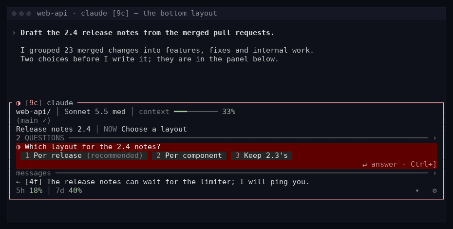
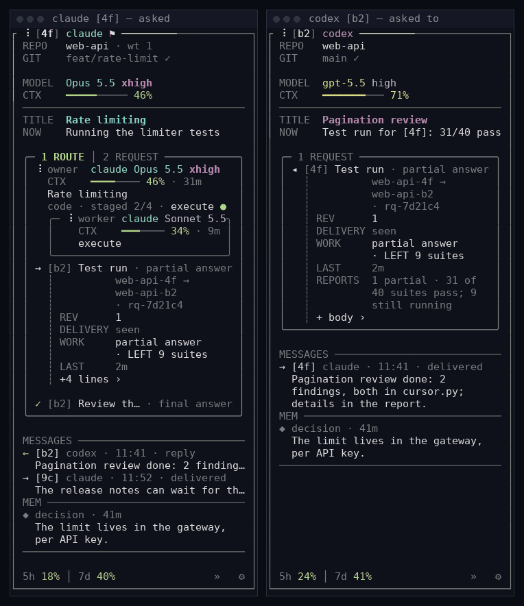

# The session panel and Fleet, in detail

The [README](../README.md#one-seat-for-every-session) shows what the panel and
Fleet are for. This page collects the keys, layouts, settings, and per-runtime
details behind them. The canonical contract is
[core/references/session-shell.md](../core/references/session-shell.md); peer
requests are specified in [core/OPERATIONS.md](../core/OPERATIONS.md)
(“Peer requests”).

- [Turning it on and off](#turning-it-on-and-off)
- [What the panel shows](#what-the-panel-shows)
- [Keys and mouse](#keys-and-mouse)
- [Narrow windows and folding](#narrow-windows-and-folding)
- [Settings](#settings)
- [Requests and messages](#requests-and-messages)
- [Per runtime](#per-runtime)
- [Fleet details](#fleet-details)

## Turning it on and off

New installations enable a common status area and a Hearting work panel for
new Claude Code, Codex, and OpenCode terminals. Updates preserve existing
choices, including older installations without a shell policy.

```bash
hearting session shell status    # the current choice
hearting session shell disable   # new terminals launch the native CLI as before
hearting session shell enable    # turn it on again
```

Existing sessions keep running either way; installation affects new wrapped
terminals, and running hosts are not replaced. Noninteractive commands and an
unavailable shell runtime run the original CLI without starting a second
native session. Herdr, cmux, and tmux remain optional.

## What the panel shows

The default is a 40-column panel on the right of the native area. Its top
border names the session the way Fleet's row does: the state glyph, the
session number (`[4f]`), the runtime, and `⚑` for a steward. The frame shows
that state the moment the native screen changes: while the session runs it
stands lit and a light passes over the rule under the model and context, while
an answer waits the whole frame breathes red, and idle stays neutral (another
motion, or none, under [Settings](#settings)). From the top:

| Rows | What they say |
|---|---|
| `REPO`, `GIT` | The repository and its linked-worktree count (`web-api · wt 1`); the branch, then `✓` when it is level with its upstream or `↑N`/`↓N`, then any merge or rebase warning. The **STATUS ›** button at the right end of the REPO row (the screen's language word) opens this session's campaign status document whole in a popup: Fleet's status lines for the project first, markdown tables as aligned columns. It is dim when there is no document yet and absent where the project keeps no artifact root |
| `PEERS` | Directly under `GIT`, the sessions tied by supervision: `[c7] ⚑  ─ [d4] [3b]`, the supervising session, its flag, two cells, a dash, then the sessions it supervises, in that order in every window. A supervised window shows only its own group (`[c7] ⚑  ─ [d4]`); a window that is both shows two groups joined by ` · `. Numbers wear their session's harness color: this window's own bold and at full strength, every other session's one step back (darker on a dark or unknown background, as the `USAGE` names are; lighter on a light one, so in 256 colors or more it is never the same color as this window's number), so the window's own number reads at once; with no color, or in 8 or 16 colors, where the two share one hue, weight alone tells them apart, the flag is Fleet's steward pink, and no session state is shown. Short of cells the last numbers become `+N`; a window with no such relation has no row. The numbers are plain text here; Fleet's session page has the same line, where they open that session's page |
| `MODEL`, `CTX` | The model and effort, and the context gauge and percent |
| `TITLE`, `NOW` | Fleet's title for the session and what it is doing now, under a thin rule. The NOW row ends in `›` like the section heads: a press opens this session's story in a popup (below). The `›` takes the last line's room only when there is some, otherwise it replaces the end of that line (`…›`), so the rows around it keep their size |
| `N QUESTIONS` | The questions waiting for you, in one thin rounded box. The line is rose where this window has a question to answer, dim where only an answer on its way or a wait answered elsewhere stands. Inside, in the body color: the first line, the choices as text (`1 label · 2 label`), and `↵ answer · Ctrl+]` at the right. An answer on its way reads `✓ answer sent · Public only` for ten minutes, the first words green. Nothing else in the panel is red but that border and a wait answered elsewhere's `◑` and count; in mono, eight colors, or `NO_COLOR` the border's weight tells the two apart |
| `N ROUTE` | The route box, one box in three zones under named rules drawn inside it (the names are English in every language): `─ direct ───` (what this session does itself; its line has no `(direct)` bracket: `● code  title`), `─ dispatch ───` (the routes this session started) and `─ request ───` (the requests it sent or received). The title counts the routes alone (`2 ROUTE`, `ROUTE` when only requests stand). A zone's name and mark have their own color: direct orange, dispatch violet, request aqua. The kind word wears the color of the route's field, `code` blue, `lab` amber, `design` rose, `docs` sand (`draft`, `refine`), `research` sky, and the bracket after it the same color by weight (`quick` dim, `standard` plain, `strong`, `thorough`, `adversarial` bold). The bracket holds two things, on two separate axes. The **form** says how the route runs: `unit` (one unit called, one thing done, no owner), `solo` (the owner alone does the whole procedure of its kind) or `team` (the owner and a worker for each stage); the words are English in every language, and they read as who makes the work (the command's `--shape solo|staged` is the `solo` and `team` shown here). The **intensity** says how heavily the procedure is walked (`quick`, `standard`, `strong`, `thorough`, `adversarial`) and belongs to all three forms, a unit's too (it is a value of the record, not of the form); it follows the form after a `·` and is always written: `● code(unit·quick)`, `● code(solo·quick)`, `● lab(team·strong)`. A record with no intensity reads the form alone (`code(team)`); a route of another shape (a frame, an older record) keeps its intensity bracket alone, an older unit route that records no field keeps its bare `unit`, a `direct` route has no bracket, and a unit a worker called stands on its caller's rows with no bracket. The whole bracket wears the color and weight of the intensity. Short of room the intensity goes first (`code(solo)`), then the bracket and the chain as before. A route with no such field (an older one is read by its kind's name) keeps the bold body word and the dim bracket, as do mono, `NO_COLOR` and fewer than 256 colors; on a light face the colors take their dark counterparts. Under the native area the route's row has no command column (`>_ Edit`), its NOW on the row under it. A zone with no rows has no rule. A route in `dispatch`: its kind, form and intensity first (`● code(team·standard)`, after the kinds it continues: `frame ✓ → code(team·standard)`) with the route's time at the right end of that line (short of room its middle text goes first, then the chain behind it and the intensity; the kind word and the time stay; none where the route has no time), its title, who works on it now (role, runtime, model, effort), under that its `CTX ━━━━───── 41%` row (the gauge and its number; a worker's own time follows it, `· 12m`; an owner has none, its time is the route's, at the end of the first line) and what that session is doing now (its NOW, up to two rows, the second ending in `…` where it goes on, none when it has none), and where it stands (`2/4: execute`, the stage name blinking; the word `staged` is never written before the position). The live workers of that stage stand under it in one box with the stage text on its top line, each a session of its own (runtime, model, effort; `CTX` row; NOW); the workers of each stage that has any stand in a box of their own, its top line that stage's position and name (two stages running at once: `2/4: eval-asr`, `3/4: eval-sep`); the setting `worker box` picks `closed` (the default), `open` (the top line and the left side only) or `none` (each stage's row and its workers hung under it by `↳`). The route's first line carries `· 3/6` (with the name, `· 3/6: execute`, where no box holds it, as when no worker runs; short of cells the name goes first, then the stage text, before the kind, the intensity or the time; where the name is not on the first line of a route with no worker, its stage row `3/6: execute` stands under the owner). A route's name takes two rows and ends in `…` where it goes on; a worker with no `CTX` value ends its first row with its own time. In `request`, the requests this session sent (`→`) or received (`◂`, `✓` closed): the first row names the other session (`[6c] other-repo claude Opus 5.5 xhigh`: its number, the name of its repository (dim; none for a session of this window's own repository), then its runtime and model, its age at the right), then the title, then the status; short of room the title goes before the repository name does. A route a request opened stands in `direct` or `dispatch` like any other. A failed route colors only its own line. A finished route stays with its result until your next input or ten minutes |
| `STATUS` (`현황`) | Second from the top, under a question to answer here: this campaign's status document as lists, `하는 중`, `기다리는 것`, `최근에 끝난 것`, `나중에 할 것`, each a head row (name, count) and its titles; five rows at least, twelve at most, later groups first become a count; a press opens the status popup. No document, no section (the REPO row's `현황 ›` button stays) |
| `MESSAGES +N` | Up to three messages, each its head (who, runtime, time, kind) and its first line; short of rows one or two rows (the newest message in its one-row form); see [Requests and messages](#requests-and-messages) |
| `MEM` | Up to three of the newest saved memory records of this repository and global ones, each a dim head (`◆` durable or `◇` working, its scope, kind, and age) over its headline |
| `RESOURCES` | Above `USAGE`: one row for each host (this machine and any configured host: `host-a  CPU 34%  MEM 61%`), under it every GPU of the host in its number's order, side by side (`GPU0  92% 21/24G [3b]  GPU1   0%  0/48G`: the use in its level's color, the number being the session that holds it, empty where Hearting does not know it; a GPU nothing runs on is the same group with the sample's values, all of it dim and with no session number), laid out as one grid for the whole section: every group the same width, the label left-aligned, the use and the memory right-aligned, the session numbers left-aligned after them (blank where there is none, so the next group keeps its place), the same number of groups on every row of every host; the host rows align the same way (the name column as wide as the longest name, `CPU` and `MEM` values right-aligned), onto the next row where they do not fit and never splitting one GPU's group. Where the width has room left and the rows would not be more, each group also has Fleet's memory gauge right before its memory number (`GPU0  93% ━━━━━━━━─ 21/24G [3b]`: the same bar as Fleet's `VRAM` gauge, the fill and level color from the memory ratio; a GPU nothing runs on has it all dim; the same width for every group, 4 to 10 cells, the widest the section has room for; the groups may then stand fewer to a row where that keeps the rows as many; not where the memory is already given up, and not on the host rows). Short of cells a host row gives up MEM, then CPU; if that is still short the name is cut with `…` (to 12 cells at least); a GPU's group gives up its memory, then its use, and keeps the session number. It is Fleet's own host sample, which the shared producer takes only while a side panel that draws this section is open (a status line alone, a bottom panel or no panel reads no host), at most once a minute however many windows are open, and not at all while Fleet is open (Fleet reads the hosts every ten seconds and leaves each sample for the producer); so it can be about two minutes old, and is not drawn past that; the panel never reads a host. Short of rows it goes first, GPU rows before host rows. A machine with no configured host and no local sample shows none |
| `USAGE` | One row each for Claude, Codex, and OpenCode with the 5h, 7d, and model windows each reports, from the usage records Fleet already keeps; nothing is fetched. A harness with none reported reads `?` |
| Last row | The gear `⚙` and the fold button `▾` |

A unit a worker called (`compose --start --unit …` run from a worker; the registry row names the worker, `caller_attempt_id`) is not a route of this box: it stands on one row right under the row of the worker that called it, two cells in, and a unit it called in turn two cells further in: `⠋ code-review claude Opus 5.5 xhigh  3m` (its mark, the unit's short name, runtime, model, effort, and its time at the right edge; short of cells the effort goes first, then the runtime, then the model, and the name and the time stay). Under the route the row stands in the route row's columns: its title two cells in, the unit's name leading the worker cell, its kind in the kind cell, its time at the end. The columns and the stage form are the route rows' own, as they read with no called unit: a route row never loses a word to the row under it, and the called row is drawn into them (its title cut with `…`, empty where no cells are left; its worker cell folded in the narrow worker line's order; its time cut to the routes' time width). Only where the columns grown by the called rows leave every route row reading the same does the box take them. A unit the owner, or the one worker of a unit route, called stands under that row; one under a worker whose `CTX` row stands stands below that row. A unit that ended cleanly leaves, so its row goes; one that is not running but not over (its process dead and its row not yet closed, waiting for a place, not known) stands under its caller with that state's mark (`✕`, `●`, `◌`), as a route row would carry it. A called unit is not counted: the box's title, a session's `route N` and Fleet's route counts are the work that session opened (the worker counts by runtime do count it, it is a session that runs). Short of rows these rows go before any other row of the route, and the strip folded to its band draws none. The same unit stands in Fleet's ROUTES and OVERVIEW as an indented row under its caller's route row, and in the route popup's table right under the row of the worker that called it (a unit the owner called, after the last worker row); a press on the row opens the route as one on its caller's row does. The route that called is read as it was before the call.

Each section head reads `N NAME counts ─── ›` (the route box carries its name
in its top line); `MEM`, `RESOURCES` and `USAGE` open nothing. Experiments and the
machine's other sessions read in Fleet (LAB, SESSIONS), not in the panel. A
40-row window keeps two or three rows per section; short of rows the other
sections step down to one row first (`RESOURCES` before any of them), then the route box folds its routes
(the closed workers' box becomes the open one, each NOW's second row goes, the `CTX` row folds into the first row, each NOW's first row goes, then the kind row, then one row each; a zone's rule stays while one row of the zone shows) and scrolls
in place under the wheel, its border counting what it hides. A press on a
section's head or rows opens its popup (below); a press on any row of a route
opens the routes popup on that route's page (Fleet's stage boxes; until its own
reading comes, the stage boxes the panel's values already draw (its top rule ends in the route's form word, `team` or `solo`, as in the route's bracket, never `staged`)), a press on the
section's head (or Ctrl+], ←→) the routes table, a request's row the MESSAGES
popup. Values the host could not refresh for a while are shown, not claimed:
nothing spins, and the frame takes no route state. A value that cannot be read
stays `?`.

The window's last line under the native screen is the shell's one line in
every harness: the working folder at the left and `hearting v<release>` at the
right (a newer release waiting takes its place). OpenCode's cost moves into its
panel. While an answer waits, the question box's border and the folded strip's
`◑to answer N` blink between two clearly different reds once a second, on
Fleet's own beat (still with rule motion `off`; not in mono or `NO_COLOR`).

## Keys and mouse

Ordinary keys stay with the native CLI. A section opens in a popup in the
middle of the window (the native area and the panel together), never by
itself: the question editor for QUESTIONS (up to 132 cells wide; the window less 4 where that is narrower), Fleet's own table at the popup's
width for ROUTE (up to 196 cells; the other table popups up to 116, text 76) (a route unfolded with its failure reason whole, Enter for its
page with its paths), the status document for STATUS, this session's story for NOW, and the requests and
messages whole for MESSAGES. While it stands every key and press is its own,
everything behind it reads in one dark gray (the native's output keeps
arriving, still gray, and the native is never told) while the popup stands on
its own lighter ground with bright words; in the question popup a thin line under the question's words (with an empty row above it) parts them from the choices, whose numbers are bold in the question's rose, and the chosen
choice stands on its own blue ground (reversed in mono, eight colors, or
`NO_COLOR`). **Esc**, **Ctrl+]**, its `✕`, or a press outside it closes it.

| Key | What it does |
|---|---|
| **Ctrl+]** | Open a popup: the question you can answer here, else the first section with something in it; again (or **Esc**) closes it |
| **←/→** | Move to the next or previous section (`STATUS · NOW · QUESTIONS · ROUTE · MESSAGES`, its name on the popup's bottom line); **Ctrl+]** skips NOW |
| **Tab**, **1–9**, **t** | In a question: the next waiting question, an option (**↑/↓** too; **PgUp/PgDn** read a long question), an answer in text, including pasted text; **p**, **f**, **r**, **w** below work while you choose and are letters while you type |
| **Enter** | In a question: send, once every form field is answered; the popup closes and keys go back to the native CLI. In ROUTE: the unfolded route's page, and again back to the table (a popup opened on a route's page goes to the table first, then back to the page) |
| **↑/↓** | In ROUTE: unfold the next route; elsewhere read on (**PgUp/PgDn** a page) |
| **↑/↓**, **Enter** | In NOW: choose a line of the story (oldest first, the latest NOW at the bottom; a prompt's own NOW values fold under it and open with it). **Enter** reads that part of the conversation in the popup and again goes back to the list; on a route line it opens that route's page, on a question or message line that section's popup. Nothing is sent to the agent's window. A very long story shows `… N earlier lines` on top where the oldest were left out |
| **p** | Fold the panel into the strip, or open a folded one (the popup closes) |
| **f** | Open Fleet in the same window; **Ctrl+]** closes it and returns |
| **r**, **w** | The MESSAGES popup; this repository's open work |
| Click | A section's head or rows open its popup; a name on the popup's bottom line moves there; the wheel reads a long table on |

Choices and drafts survive moving between questions. Once an answer is sent,
the panel keeps one line, `✓ answer sent · <choice>`, until the session has
it. A transport receipt is
shown separately from proved consumption, and expired or cancelled questions
cannot be submitted. In a question, **↑/↓** scroll long content and an explicit
count marks the hidden lines; a question section with nothing in it is not
drawn. A question that has to be answered somewhere else says
where instead of offering choices: `answer below` (in the native input),
`answer in its window`, or `answer in the parent`. Only **f** opens Fleet. In
Fleet, **Ctrl+]** on a session page opens that exact session's panel.

<p align="center">
  
</p>
<p align="center"><sub>The bottom layout: the question to answer here in a rose-bordered box, which <b>Ctrl+]</b> or a press opens in the popup. The conversation is illustrative; demo data.</sub></p>

## Narrow windows and folding

**▾** at the right end of the last row, right of the gear (**▾** also when the
panel is under the native area), folds the panel into a strip under the native
area, whose **▴** opens it again from the same corner; the native area gets
the whole width back. The strip is one row at any window height:
`● [4f] web-api │ Opus 5.5 xhigh │ CTX ━━━━──── 46% │ 5h 12% │ 7d 66% │ ◑to answer 1 │ 3 ROUTE ⠏2 ✕1 │ MESSAGES ← [b2] → [9c]`
with **▴** at its right end. The wait shows only while you owe an answer; compaction about to
happen or a tidy notice takes its place; the Git branch follows the project
where it fits. Narrow, whole values go: reset times, branch, effort, 7d, 5h,
the model, the message sessions (their count stays), MESSAGES, the project, a
window at Fleet's red level (it outlasts the other windows), the context bar
(its percent stays), the route counts, and at 30 cells the session number; the
state, wait, `N ROUTE`, and **▴** stay. A press on the wait opens the question
popup, on the routes or MESSAGES their popup above the strip, anywhere else
opens the panel again; from the keyboard, **Ctrl+]** then **p**. Where the open
panel would leave the native area under 60 columns (a 40-column panel in a
terminal under 102 columns) it folds by itself into the same strip and opens
again with room; a choice made by hand holds at every width. In the bottom
layout (when `layout` is set to bottom, or when you open the panel by hand in a
window too narrow to hold it beside the native area, until the window widens)
the panel sits under the native area.

## Settings

While a session works, its working spinners (the head line's, and the owner, worker and frame-leg rows of the route box, wherever the row names its harness) turn in that harness's color, and the moving frame and the head rule's light (every `rule motion` kind) take steps of the same color; stopped, waiting, failed and finished marks and a window with no known harness keep their state colors, and a waiting session's red breath is unchanged.

**⚙** (the gear at the right end of the panel's last row, left of the fold button) previews placement,
panel position (right or left), width, narrow-window behavior, bottom height,
auxiliary detail, route line, worker box (`closed`, the default, `open`, or
`none`: how a stage's workers stand in the route box), rule motion (`rule`, the default: the lit frame
and the light over the rule; `border`: one arc round the frame; `scanners`: a
wide wave round it; `off`), theme (terminal, light terminal, or monochrome),
and shade (none, light, or medium). Use the value arrows or keyboard arrows, then Apply; Cancel
restores the previous view, and Defaults previews the defaults. Drag the side
boundary to resize and save it. Only Hearting's own `session-shell.json` is
saved, with a byte-for-byte backup; native model and permission settings are
untouched. Existing explicit layout choices are retained.

## Requests and messages

A **request** is work handed from one session to another, with a number,
revisions, and reports. You ask in your own words (“Ask session [b2] to re-run
the tests and report back”); the agent runs the commands:

```bash
hearting run peer-steward request <session> --body-file <file>   # new request; --rev <label> supersedes, <rq-id> --cancel withdraws
hearting run peer-steward report [<rq-id>] --partial --result "<line>"   # or --reject "<why>", or a final report without --partial
hearting run peer-steward show [<rq-id>]                         # the sealed body; no id: this session's open requests
```

The line that reaches the other conversation names the request; the body
stays sealed, and the receiving model opens it with `show`. Delivery and work
are separate: a receipt does not change a request's state; only a final or
reject report, or the requester's cancel, closes it, and a partial report keeps
it open. A report is not approval, release, or a user answer. A request
follows the other session to a successor only when Hearting's lineage confirms
the handover.

In the panel, every open request has rows in the route box's `request` zone, under its own rule:
`→ [b2] codex gpt-5.5 high   2m`, its title, then `partial answer`; a request row opens the MESSAGES popup. The
popup shows it whole, requests first: the
parties and number, `REV`, `DELIVERY` (`sent`, `delivered`, `seen`; `awaiting delivery` and why while the other window has not taken it in, as `peer-steward show` says), `WORK`
(`open`, `partial answer`, `final answer`, `rejected`, `cancelled`, with what is
left), `LAST`, `REPORTS`, and the body. A closed request stays 15 minutes after it closed, sent or received (`✓` answered, `✕` rejected or cancelled); a sent one
stays longer until its last answer has been seen.

A message you sent that has not gone into the other window reads the same in `MESSAGES` (`→ [b2] · awaiting delivery · text stands in its input …`): the first words always show, the reason as far as the row reaches, and the `MESSAGES` popup shows it whole.

<p align="center">
  
</p>

**Messages** are short notes, sent with
`hearting run peer-steward prompt <session> --body-file <file>`; reply text
addressed to another session in a conversation reaches nobody. **Watching**
(`hearting run peer-steward watch <session>`) wakes the watcher once when the
watched session finishes, stops, or needs a person. None of these needs herdr
or tmux.

How an idle session is reached differs by runtime
([core/ADAPTATION.md](../core/ADAPTATION.md), PG-58 and PG-59):

- In a terminal with the panel, the shell injects a waiting message, request
  line, or report into an idle Claude Code, Codex, or OpenCode session when its
  input is empty and no form is open. With text typed or a menu open it waits,
  and the sender sees `awaiting delivery` with the reason.
- Codex takes them through its own thread queue, with or without the panel.
- Outside the panel's terminal, Claude Code takes them at its next callback
  (an idle session at your next prompt), and OpenCode at its next idle or tool
  callback. Neither is woken at once; the request stays open and listed on
  both sides.
- A watch wakes Claude Code everywhere it was measured. Codex is woken where
  Hearting has proven its terminal; otherwise, and on OpenCode, `watch` prints
  a command to wait on (`bounded-wait` with a `join`) instead of promising a
  wake.

Fleet lists a session's requests on its session page, in the `request` zone of its route list, and shows the newest as a PEERS
link; it has no list of every request across sessions, and you cannot send a request or
message from Fleet yet.

## Per runtime

- **Claude Code.** The panel shows the same status area as Codex and OpenCode,
  and the row under the input is the shell's one line there too (the working
  folder and `hearting v<release>`). What you must do now stands in the panel
  or its folded strip: an answer you owe in the question box and the strip's
  `◑to answer N`, compaction about to happen in the panel's top and the strip's
  `⚠`, a red usage reading in `USAGE` and on the strip (on a narrow strip the
  other windows go first and the red one stays), a failed or blocked route in
  the route box and the strip's `✕N`. News stays in the panel: messages in
  `MESSAGES`, a finished route's result in the route box. Where the panel is
  not painted (Fleet over the window, the settings screen, a window not yet
  bound), Claude's own statusline shows the status line itself, keeping what
  is urgent first on a narrow screen.
- **Codex.** A wrapped Codex keeps its native shared-daemon startup. The shell
  hides the footer's thread ID (it stays on the inner screen for
  identification; a Codex window without the shell still shows it), and the
  rest of that row can yield duplicate paint to the common area. Custom,
  clipped, or uncertain rows remain visible. Codex context keeps the latest
  server-reported usage; a separate `compaction imminent` label appears only
  when the exact session's current native diagnostic supports it, and
  unavailable or stale diagnostic data stays unknown. The 500K/700K
  preservation notices do not guarantee remaining time before native
  compaction.
- **OpenCode.** It uses the same panel and settings. Its own sidebar is hidden
  in the shell window (OpenCode's toggle still opens it), with Context in its
  footer and its MCP server count in the panel; its cost stands after the
  context in the panel.

Where independent telemetry cannot provide a value, the native context display
remains as a fallback. Answers keep the existing queue and consumption
receipts; an unproved native target stays pending.

## Fleet details

- **NOW and the expanded row.** NOW is what the session is doing now (`·`
  when nothing is observed). Expand a row in OVERVIEW for LAST INPUT and
  RECEIVED: `› 1m · …` is your last confirmed input, `› ?` means the text
  cannot be confirmed (including older inputs whose first line was not kept,
  or sessions with no readable input record), and `› ·` means no human input
  was recorded. Received peer and runtime messages show their first lines
  without notification wrappers.
- **The project page.** Select a project in the session list for its campaign status
  (up to three campaign summaries), backlog and work in progress, open
  requests and stages, completed results, recent small work records, its
  `LAB` table (the experiment board, which the panel does not draw), and its
  sessions. Open work uses the same records as MEMORY;
  saving a memory does not count as completing a task.
- **Pages and raw output.** Select a session or a request to open its page,
  and from there its raw output: tool calls and results in order, without
  opening the runtime itself.
- **Commands.** `fleet --once` and `fleet --json` need no `curses`, so they
  also work on Windows under Git Bash; `fleet-monitor` is the earlier
  group/process view. Session titles follow your language; set
  `title_language` in `${XDG_CONFIG_HOME:-~/.config}/hearting/fleet.json` to
  override it.
- **First screen.** A newly started window draws its first screen as soon as
  the session list is read and marks the cells still loading `details wait`;
  the rest fills in as it is read.
