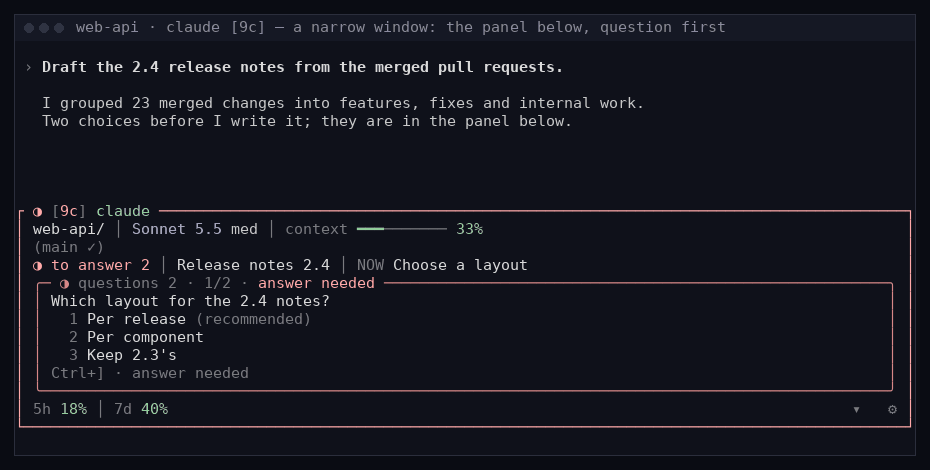
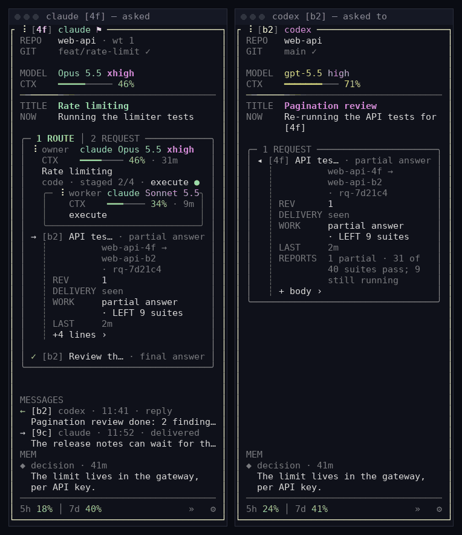

# The session panel and Fleet, in detail

The [README](../README.md#one-seat-for-every-session) shows what the panel and
Fleet are for. This page collects the keys, layouts, settings, and per-runtime
details behind them. The canonical contract is
[core/references/session-shell.md](../core/references/session-shell.md); peer
requests are specified in [core/OPERATIONS.md](../core/OPERATIONS.md)
(“Peer requests”).

- [Turning it on and off](#turning-it-on-and-off)
- [What the panel shows](#what-the-panel-shows)
- [Keys and mouse](#keys-and-mouse)
- [Narrow windows and folding](#narrow-windows-and-folding)
- [Settings](#settings)
- [Requests and messages](#requests-and-messages)
- [The LAB section](#the-lab-section)
- [Per runtime](#per-runtime)
- [Fleet details](#fleet-details)

## Turning it on and off

New installations enable a common status area and a Hearting work panel for
new Claude Code, Codex, and OpenCode terminals. Updates preserve existing
choices, including older installations without a shell policy.

```bash
hearting session shell status    # the current choice
hearting session shell disable   # new terminals launch the native CLI as before
hearting session shell enable    # turn it on again
```

Existing sessions keep running either way; installation affects new wrapped
terminals, and running hosts are not replaced. Noninteractive commands and an
unavailable shell runtime run the original CLI without starting a second
native session. Herdr, cmux, and tmux remain optional.

## What the panel shows

The default is a 40-column panel on the right of the native area. Its top
border names the session the way Fleet's row does: the state glyph, the
session number (`[4f]`), the runtime, and `⚑` for a steward. The frame takes
that state's color the moment the native screen changes (running, waiting;
idle stays neutral). From the top:

| Rows | What they say |
|---|---|
| `REPO`, `GIT` | The repository and its linked-worktree count (`web-api · wt 1`); the branch, then `✓` when it is level with its upstream or `↑N`/`↓N`, then any merge or rebase warning |
| `MODEL`, `CTX` | The model and effort, and the context gauge and percent |
| `TITLE`, `NOW` | Fleet's title for the session and what it is doing now, under a thin rule that moves while the session runs and breathes red while an answer waits |
| `N ROUTE` box | Each current route on its own folded row: Fleet's route mark, title, runtime, context, and elapsed time (or the model, with `route line` set to `model`). The owner comes first, and the worker running the current stage sits in its own box under it. Press a row to open it in place: model, effort, gauge, `plan ✓ › execute ● › review`, `>_ tool`, `+N agent` |
| `M REQUEST` | Requests this session sent (`→`) or received (`◂`), and finished ones (`✓`); see [Requests and messages](#requests-and-messages) |
| `LAB` | This project's experiment board; see [The LAB section](#the-lab-section) |
| Question box | A question waiting for you, its choices, and how to answer |
| `MESSAGES` | Recent messages, each on two rows: `← [b2] codex · 11:41 · reply` and the start of its text; a sent one shows its delivery (`delivered`) |
| `MEM` | This repository's newest saved memory records, two at most (`◆ decision · 3m` and its headline) |
| Last row | The usage windows (`5h 18% │ 7d 40%`), the fold button `»`, and the gear `⚙` |

Every current route has a row; when the box cannot show them all it scrolls in
place, and the routes hidden above and below are counted in its borders
(`↑2`, `↓3`). A failed route colors only its own box. Values the host could
not refresh for a while are shown, not claimed: nothing spins, and the frame
takes no route state. A value that cannot be read stays `?`.

## Keys and mouse

Ordinary keys stay with the native CLI until you focus the panel.

| Key | What it does |
|---|---|
| **Ctrl+]** | Focus the panel; press again (or **Escape**) to return to native typing |
| **Tab** | Move between waiting questions |
| **1–9**, **↑/↓** | Choose an option (focused ↑/↓ scrolls long question content) |
| **t** | Answer in text, including pasted text |
| **Enter** | Send, once every form field is answered |
| **f** | Open Fleet in the same window; **Ctrl+]** closes it and returns |
| **PgUp/PgDn** | Scroll the route box while no question is shown |
| Click | Open a route, a request, a message, or the `LAB` table in place; the wheel scrolls the route box |

Choices and drafts survive moving between questions. A transport receipt is
shown separately from proved consumption, and expired or cancelled questions
cannot be submitted. A question that has to be answered somewhere else says
where instead of offering choices: `answer below` (in the native input),
`answer in its window`, or `answer in the parent`. No press in the
panel opens Fleet except **f**. In Fleet, **Ctrl+]** on a session page opens
that exact session's panel.

<p align="center">
  
</p>
<p align="center"><sub>The bottom layout, opened in a narrow window: the question comes first. The conversation is illustrative; demo data.</sub></p>

## Narrow windows and folding

**»** beside the gear folds the side panel into an eight-cell strip (state,
session number, route count, `LB` for experiments, answer waits) and gives the
native area the freed columns; a press on the strip opens it again. Where the
open panel would leave the native area under 80 columns (a 40-column panel in
a terminal under 122 columns) it folds by itself and opens again with room; a
choice made by hand wins at that width. In the bottom layout (when `layout` is set to bottom,
or when you open the panel in a window too narrow to hold it beside the native
area) the panel sits under the native area, the question comes first, and
**▾** / **▴** fold it to one status row.

## Settings

**⚙** (the gear at the right end of the panel's last row) previews placement,
panel position (right or left), width, narrow-window behavior, bottom height,
auxiliary detail, route line, rule motion, theme (terminal, light terminal, or
monochrome), and shade (none, light, or medium); the defaults keep the
original look. Use the value arrows or keyboard arrows, then Apply; Cancel
restores the previous view, and Defaults previews the defaults. Drag the side
boundary to resize and save it. Only Hearting's own `session-shell.json` is
saved, with a byte-for-byte backup; native model and permission settings are
untouched. Existing explicit layout choices are retained.

## Requests and messages

A **request** is work handed from one session to another, with a number,
revisions, and reports. You ask in your own words (“Ask session [b2] to re-run
the tests and report back”); the agent runs the commands:

```bash
hearting run peer-steward request <session> --body-file <file>   # new request; --rev <label> supersedes, <rq-id> --cancel withdraws
hearting run peer-steward report [<rq-id>] --partial --result "<line>"   # or --reject "<why>", or a final report without --partial
hearting run peer-steward show [<rq-id>]                         # the sealed body; no id: this session's open requests
```

The line that reaches the other conversation names the request; the body
stays sealed, and the receiving model opens it with `show`. Delivery and work
are separate: a receipt does not change a request's state; only a final or
reject report, or the requester's cancel, closes it, and a partial report keeps
it open. A report is not approval, release, or a user answer. A request
follows the other session to a successor only when Hearting's lineage confirms
the handover.

In the panel, every open request has a row in the route box's border group
(`2 REQUEST`): `→ [b2] API tests · partial answer`. Opened, it shows the
parties and number, `REV`, `DELIVERY` (`sent`, `delivered`, `seen`), `WORK`
(`open`, `partial answer`, `final answer`, `rejected`, `cancelled`, with what is
left), `LAST`, `REPORTS`, and `+ body ›`. A closed request this session sent
stays 15 minutes after it closed, or until its last answer has been seen.

<p align="center">
  
</p>

**Messages** are short notes, sent with
`hearting run peer-steward prompt <session> --body-file <file>`; reply text
addressed to another session in a conversation reaches nobody. **Watching**
(`hearting run peer-steward watch <session>`) wakes the watcher once when the
watched session finishes, stops, or needs a person. None of these needs herdr
or tmux.

How an idle session is reached differs by runtime
([core/ADAPTATION.md](../core/ADAPTATION.md), PG-58 and PG-59):

- In a terminal with the panel, the shell injects a waiting message, request
  line, or report into an idle Claude Code, Codex, or OpenCode session.
- Codex takes them through its own thread queue, with or without the panel.
- Outside the panel's terminal, Claude Code takes them at its next callback
  (an idle session at your next prompt), and OpenCode at its next idle or tool
  callback. Neither is woken at once; the request stays open and listed on
  both sides.
- A watch wakes Claude Code everywhere it was measured. Codex is woken where
  Hearting has proven its terminal; otherwise, and on OpenCode, `watch` prints
  a command to wait on (`bounded-wait` with a `join`) instead of promising a
  wake.

Fleet does not list requests yet, and you cannot send a request or message from
Fleet yet.

## The LAB section

When the project has an experiment board, the LAB section stands right under
the route box. Folded it reads `3 LAB 12:00` (the selected group's condition
count, the word, the board's read time) with its most pressing counts at the
right (`failed 1`, `stuck 1`, `unknown 1`, `waiting 1`, else `running 3`), the
goal, and the one condition to look at. A press opens the condition table in
place (name and progress, then latest and difference or the state, as the
width allows; the values a row does not show go under it) and a press closes it. The panel and Fleet's `LAB` table on the
project page word a condition alike, from the same board. No experiments and no
problem means no section; a broken catalog or an unnamed run is an unconfirmed
warning, never “no experiments”. An experiment's failure never colors the
frame. The board's files join the panel's file watch, so a new record redraws
it without polling.

## Per runtime

- **Claude Code.** The panel shows the same status area as Codex and OpenCode.
  While the panel shows it, Claude's own statusline row below becomes a notice
  row that stays empty unless you owe an answer, a warning applies, or news
  just arrived; the full statusline returns whenever the panel is hidden.
- **Codex.** A wrapped Codex keeps its native shared-daemon startup. The shell
  hides the footer's thread ID (it stays on the inner screen for
  identification; a Codex window without the shell still shows it), and the
  rest of that row can yield duplicate paint to the common area. Custom,
  clipped, or uncertain rows remain visible. Codex context keeps the latest
  server-reported usage; a separate `compaction imminent` label appears only
  when the exact session's current native diagnostic supports it, and
  unavailable or stale diagnostic data stays unknown. The 500K/700K
  preservation notices do not guarantee remaining time before native
  compaction.
- **OpenCode.** It uses the same panel and settings. Its own sidebar is hidden
  in the shell window (OpenCode's toggle still opens it), with Context in its
  footer and its MCP server count in the panel.

Where independent telemetry cannot provide a value, the native context display
remains as a fallback. Answers keep the existing queue and consumption
receipts; an unproved native target stays pending.

## Fleet details

- **NOW and the expanded row.** NOW is what the session is doing now (`·`
  when nothing is observed). Expand a row in OVERVIEW for LAST INPUT and
  RECEIVED: `› 1m · …` is your last confirmed input, `› ?` means the text
  cannot be confirmed (including older inputs whose first line was not kept,
  or sessions with no readable input record), and `› ·` means no human input
  was recorded. Received peer and runtime messages show their first lines
  without notification wrappers.
- **The project page.** Select a project in SESSIONS for its campaign status
  (up to three campaign summaries), backlog and work in progress, open
  requests and stages, completed results, recent small work records, its
  `LAB` table, and its sessions. Open work uses the same records as MEMORY;
  saving a memory does not count as completing a task.
- **Pages and raw output.** Select a session or a request to open its page,
  and from there its raw output: tool calls and results in order, without
  opening the runtime itself.
- **Commands.** `fleet --once` and `fleet --json` need no `curses`, so they
  also work on Windows under Git Bash; `fleet-monitor` is the earlier
  group/process view. Session titles follow your language; set
  `title_language` in `${XDG_CONFIG_HOME:-~/.config}/hearting/fleet.json` to
  override it.
- **First screen.** A newly started window draws its first screen as soon as
  the session list is read and marks the cells still loading `details wait`;
  the rest fills in as it is read.
